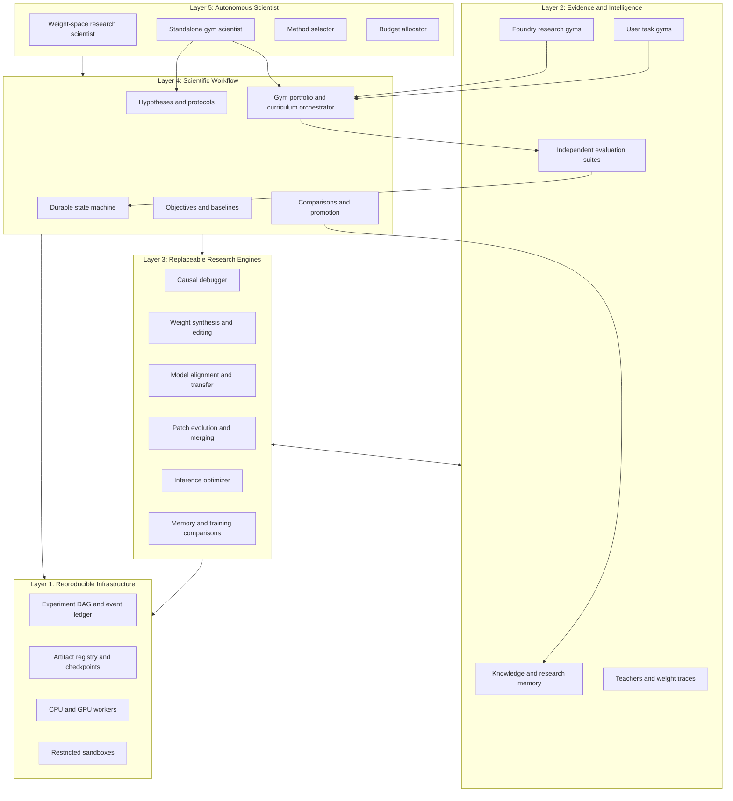

# Design: Neural Programming Foundry — Open-Source Architecture

## 1. Purpose, scientific thesis, and scope

The Foundry is a research operating system for programmable neural networks: bring a model, bring task-specific gyms, and describe the objective. User gyms and built-in Foundry gyms are equal first-class inputs, not an optional integration layer. Its autonomous scientist develops a model understanding, builds a task-aware gym portfolio, tests causal hypotheses, programs weights, compares branches, and preserves both discoveries and failures. Direct weight-space programming remains its primary research mechanism, not a new name for training automation.

The central loop is:

```text
objective -> model understanding -> gyms -> causal hypotheses
         -> neural programs -> controlled experiments
         -> branch / refine / combine / revert
         -> independent verification -> scientific memory
```

A successful patch is behavioral evidence, not proof of its proposed mechanism. A small checkpoint is not evidence of faster serving. A useful teacher is not evidence that raw weights transfer. These distinctions are enforced in the data model and promotion rules.

This revision implements the original requirements at `/mnt/c/Users/NotAPC/Desktop/weightspaceprogramming/.kiro/specs/exactly-weight-space-programming-means-directly/requirements.md`, the user's Foundry 2.0 expansion, and the subsequent open-source Rust + Python + CUDA/Triton request, and the first-class user-gym portfolio expansion. The approved requirements file is preserved. Section 22 maps the accumulated refinements and identifies superseded decisions. Design approval covers the expanded technical contract; no tasks are authored until that approval.

The starting repository has no implementation to extend. The product is an Apache-2.0 Rust workspace, native CLI, and Python research SDK in one monorepo. It runs locally without a hosted account, proprietary model, or remote control plane. GPU, sandbox, teacher, and serving integrations are optional capabilities. It is not a production deployment controller. Reading papers, downloading models, training proposers, and running experiments each require their own authorized execution and budgets.

The current delivery plan separates the minimum research product from the full platform through milestones M1–M5. M1 and M2 are independently usable without an autonomous scientist, four external gym frameworks, broad scientific memory, or general transfer. A standalone Gym Scientist, an explicit Transformation Search Space, and cross-model intervention learning extend that base. The first real scientific target is Autonomous Weight Repair on an Unseen Pretrained Model, not reproduction of a published edit.

Isolation, attribution classification, and requirements 1–14 remain enforceable capability/acceptance gates rather than assumed demo behavior. The user reports in-process generated-gym execution and backward-based attribution in current demos; this spec-only checkout does not establish that those implementations have been corrected. No existing demo is grandfathered into acceptance, direct-only status, or a verified library entry. Section 27 defines the required evidence before any such claim.

The foundation is a versioned Weight Intermediate Representation (Weight IR): an open, typed contract between scientific agents and safe transformation executors. Researchers can use the full Python SDK without writing Rust. Rust owns core correctness, checkpoint processing, compilation, durable orchestration, and concurrency; existing optimized tensor backends own heavy arithmetic.

### Evidence boundaries

- Synthetic software tests establish workflow correctness, not a breakthrough on pretrained models.
- Independently trained models, different initializations, different sizes, and different architectures are separate evidence strata.
- Unsupported methods return a typed outcome rather than silently using an easier substitute.
- Paper-inspired engine names do not establish paper fidelity. The supplied research references are design inspiration, not independently verified implementation specifications.
- A research opportunity can remain unresolved while the system correctly reports why its experiment failed.

## 2. Five-layer architecture



### Ownership and replaceability

| Layer | Owns | Cannot override |
| --- | --- | --- |
| Scientist | Proposed plans, hypotheses, method choices, budget allocations | Approved objective, permissions, hard budgets, hidden tests |
| Workflow | Scientific transitions, experiment protocols, comparisons, promotion | Artifact identities, method history, existing evidence |
| Engines | Typed diagnostics, proposals, transformations, measurements | Gate thresholds, holdout access, resource ceilings |
| Sources | Versioned observations, knowledge, teachers, datasets | Agent instructions, execution privileges |
| Infrastructure | Scheduling, isolation, hashes, storage, recovery | Scientific truth or causal interpretation |

Every engine implements a common `ResearchEngine` protocol: `describe()`, `validate(request)`, `estimate(request)`, `execute(request, capabilities)`, and `collect(operation_id)`. Descriptions declare version, supported model signatures, input/output schemas, required privileges, resource limits, determinism, training behavior, and runtime dependencies. The registry rejects incompatible engine versions before dispatch. Installing an engine is an operator action; a model cannot import one by naming it.

The planner receives capabilities, evidence summaries, remaining budgets, and permissible next transitions. It can propose a better method or a revised study. A deterministic policy broker decides whether the proposal is legal. No planner tool exposes a shell, unrestricted database query, final labels, or checkpoint replacement.

## 3. Language ownership and monorepo

### Stack and authority

| Concern | Owner and implementation |
| --- | --- |
| Core contracts | Rust `nf-core`: strict serde types, canonicalization, capability policies, typed errors |
| Checkpoints | Rust `nf-checkpoint`: Safetensors, sharded indexes, hashing, bounded streaming I/O |
| Weight IR | Rust `nf-weight-ir`: parser, type/effect checker, lowering, schema/version compatibility |
| Tensor surgery | Rust `nf-surgeon`: execution plans, CPU reference operations, backend dispatch, receipts |
| Architecture graph | Rust `nf-graph`: dependent dimensions, module/config rewrites, graph verification |
| Patch history | Rust `nf-patches`: immutable patches, conflict detection, composition, replay |
| Experiments | Rust `nf-experiments`: durable state, DAG, budgets, leases, event ledger, frontier records |
| Native CLI | Rust `nf-cli` using clap; same core entry points as Python |
| Python binding | PyO3 extension `neural_foundry._native`, built with Maturin |
| Research | Python 3.11+, PyTorch, optional Hugging Face/TransformerLens/circuit tools |
| Heavy GPU arithmetic | Existing PyTorch/CUDA libraries first; optional profiled Triton/CUDA kernels |
| Storage | Rust-owned SQLite transactions and content-addressed local blobs |
| Verification | Cargo unit/integration/property tests plus pytest cross-language/e2e tests |
| Distribution | Cargo workspace, Maturin wheels/source builds, optional research/backend extras |
| Distributed services | Go deferred; no Go runtime or Kubernetes dependency in the initial product |

Rust is not assumed to make a matrix multiplication faster. Expected systems gains are bounded checkpoint I/O, lower orchestration overhead, controlled memory movement, concurrency, and fewer accidental full-model copies. These are measured separately from GPU kernel time.

### Workspace layout

The existing checkout is the monorepo root; no nested clone or renamed project directory is introduced. These are planned implementation locations, not files created during specification:

| Absolute location | Ownership |
| --- | --- |
| `/mnt/c/Users/NotAPC/Desktop/weightspaceprogramming/Cargo.toml` | Rust workspace definition |
| `/mnt/c/Users/NotAPC/Desktop/weightspaceprogramming/pyproject.toml` | Maturin build and Python package/extras |
| `/mnt/c/Users/NotAPC/Desktop/weightspaceprogramming/crates/nf-core` | Contracts, identities, permissions, errors |
| `/mnt/c/Users/NotAPC/Desktop/weightspaceprogramming/crates/nf-checkpoint` | Safe checkpoint import/export and hashing |
| `/mnt/c/Users/NotAPC/Desktop/weightspaceprogramming/crates/nf-weight-ir` | Weight IR and compiler |
| `/mnt/c/Users/NotAPC/Desktop/weightspaceprogramming/crates/nf-surgeon` | Validated tensor execution |
| `/mnt/c/Users/NotAPC/Desktop/weightspaceprogramming/crates/nf-graph` | Architecture and shape dependency graph |
| `/mnt/c/Users/NotAPC/Desktop/weightspaceprogramming/crates/nf-patches` | Versioned programs and composition |
| `/mnt/c/Users/NotAPC/Desktop/weightspaceprogramming/crates/nf-experiments` | State machine, lineage, budgets, scientific graph |
| `/mnt/c/Users/NotAPC/Desktop/weightspaceprogramming/crates/nf-cli` | Native `nf` command |
| `/mnt/c/Users/NotAPC/Desktop/weightspaceprogramming/crates/nf-python` | PyO3 boundary, not a second core |
| `/mnt/c/Users/NotAPC/Desktop/weightspaceprogramming/python/neural_foundry` | Public SDK, workflow facade, provider registry |
| `/mnt/c/Users/NotAPC/Desktop/weightspaceprogramming/python/neural_foundry/models` | PyTorch/HF factories and runtime bridges |
| `/mnt/c/Users/NotAPC/Desktop/weightspaceprogramming/python/neural_foundry/interpret` | Causal debugger, TransformerLens and tracing adapters |
| `/mnt/c/Users/NotAPC/Desktop/weightspaceprogramming/python/neural_foundry/gyms` | Gym import/generation/composition adapters |
| `/mnt/c/Users/NotAPC/Desktop/weightspaceprogramming/python/neural_foundry/agents` | Local/remote scientist and proposal providers |
| `/mnt/c/Users/NotAPC/Desktop/weightspaceprogramming/python/neural_foundry/evals` | Independent evaluation and statistical workers |
| `/mnt/c/Users/NotAPC/Desktop/weightspaceprogramming/python/neural_foundry/synthesis` | Rule compilers, learned proposals, transfer research |
| `/mnt/c/Users/NotAPC/Desktop/weightspaceprogramming/python/neural_foundry/serving` | PyTorch, vLLM, TensorRT-LLM measurements |
| `/mnt/c/Users/NotAPC/Desktop/weightspaceprogramming/kernels` | Optional qualified Triton/CUDA kernels |
| `/mnt/c/Users/NotAPC/Desktop/weightspaceprogramming/protocols` | Versioned language-neutral schemas and conformance vectors |
| `/mnt/c/Users/NotAPC/Desktop/weightspaceprogramming/examples` | Offline reproducible direct-edit examples |
| `/mnt/c/Users/NotAPC/Desktop/weightspaceprogramming/benchmarks` | Public benchmark protocols, harnesses, result schemas |
| `/mnt/c/Users/NotAPC/Desktop/weightspaceprogramming/docs` | API, IR, architecture, safety, and contributor docs |

Core crates do not depend on PyO3 or a Python interpreter. Dependencies flow from `nf-core` into checkpoint/graph/IR crates, then surgeon/patches, then experiments and the CLI/bindings. Research engines register through typed protocols rather than creating circular crate dependencies. Python may orchestrate user-facing calls, but it does not duplicate authoritative validation, lineage mutation, or SQLite writes.

### Rust–Python boundary

Pydantic models provide Python ergonomics; Rust validation is authoritative. Both use versioned protocol fixtures and one canonical identity algorithm. Python submits canonical records to the extension and receives immutable handles, typed results, or errors with stable codes, operation IDs, and field locations. Panics are contained at FFI boundaries and mapped to infrastructure failures, never scientific rejections or process-unsafe unwinding.

Release the GIL for pure Rust hashing, I/O, validation, and scheduling. Reacquire it only for declared Python callbacks, without holding database transactions or core locks. Async work uses cancellation handles and a bounded worker pool; callbacks cannot bypass experiment/budget checks or reenter a locked coordinator.

### Python-first research and gym authoring

Python is the default language for writing gyms, research engines, agent integrations, scorers, oracles, and model adapters. Users do not need to implement a Rust plugin to bring a task. This applies the user's tentative Python preference at the research boundary while retaining the previously requested Rust systems core; it does not introduce a second Python-owned checkpoint editor.

| Action | Python responsibility | Rust responsibility |
| --- | --- | --- |
| Import a gym | Framework adapter and metadata normalization | Path/artifact checks, schema, identity, permission policy |
| Generate a gym | Tasks, scorer/oracle proposals, validation experiments | Budget, restricted execution dispatch, approval/version records |
| Build a portfolio | Task-aware coverage and curriculum proposals | Frozen bindings, required roles, constraints, legal transitions |
| Run episodes | Model/environment interaction in scoped workers | Leases, quotas, cancellation, event/receipt ingestion |
| Analyze outcomes | Statistical estimators, interference/transfer results | Evidence completeness, protocol binding, promotion gates |
| Propose weight edits | Scientific reasoning and structured Weight IR | Parse/type/effect/shape checks and backend execution plan |
| Execute tensor work | Trusted PyTorch backend where selected | Native reference and validated backend dispatch, source integrity |
| Preserve findings | Typed claims and supporting/contradicting evidence | Atomic persistence, access policy, provenance, immutable IDs |

Python scoring is not reimplemented in Rust. Rust can enforce the declared protocol, evidence binding, allowed numeric outputs, and hard thresholds; it cannot establish that an arbitrary scorer measures the intended capability. Scorer validation and independent evaluations supply that scientific evidence. Python statistical workers return bounded, versioned analysis artifacts to the same core gate rather than writing acceptance status directly.

The core communicates with Python gym/evaluation workers through versioned request/result envelopes over private local IPC, containing operation/lease IDs, immutable inputs, allowed tools, split-access class, and output bounds. These workers do not receive a database writer, unrestricted artifact root, coordinator credential, or capability to change thresholds. Final scorers and proposal agents run in different access domains. Large payloads use scoped artifact handles instead of passing whole datasets through JSON or FFI.

Tensor exchange prefers process-local ownership-aware handles or DLPack where supported. Negotiate dtype, device, strides, alignment, stream ordering, producer/consumer lifetime, and single-use capsule ownership. Cross-process workers use validated manifests and bounded shared-memory/file handles, never serialized raw pointers. No mutable view of source checkpoint memory is exposed to PyTorch. Zero-copy is a capability to verify, not a guarantee: each actual copy, device transfer, and peak allocation is recorded.

Optional PyTorch/NumPy/backend dependencies do not become mandatory for Rust-only validation or checkpoint commands. Native checkpoint and CPU edit examples must run without importing Python. Full model inference and research evaluation can require the selected Python adapter.

### Checkpoint I/O and memory discipline

Use the existing Rust Safetensors implementation, not a new tensor file format. Validate headers, byte lengths, checked dimension arithmetic, supported dtypes, duplicate names, shard indexes, missing/extra shards, and declared buffer/alias metadata. Preserve model configuration and tokenizer files as hashed inert assets; do not execute remote custom model code.

Read immutable verified snapshots, optionally via read-only memory maps. Stream untouched shards and hash bounded chunks; stage replacement shards instead of materializing a second whole model by default. Sparse patch storage does not imply free export: standard standalone Safetensors export can require rewriting a whole affected shard, which is costed and measured. Source identity is checked before and after staged work; writable aliases or mutable source-file replacement invalidate execution.

Host/device staging has explicit allocation reservations. Chunk sizes, pinned memory, transfer streams, and concurrent checkpoint reads are bounded. Hashing GPU parameters may require a device-to-host copy; it is neither hidden nor described as zero cost. Multi-GPU execution is capability-declared rather than assumed in the first CPU/single-GPU implementation.

Durable storage is an explicit user-selected root. The program does not invent a persistent location, contact a model hub, or bind a public service at startup. Any managed local serving process binds explicitly to `127.0.0.1`; remote destinations require separate authorization.

## 4. Data model, identity, and lineage

All scientific records contain a schema version, content identity, creation event, provenance class, and access classification. Canonical JSON uses sorted keys, UTF-8, strict enum values, and finite numbers. SHA-256 identifies immutable manifests and blobs. Parameter identity covers canonical tensor names, shapes, dtypes, and contiguous CPU bytes. Runtime and graph identities are distinct from parameter identity.

| Record | Essential fields |
| --- | --- |
| `ResearchObjective` | Capability or efficiency goal, constraints, claim scope, source or synthesis mode, approval |
| `StudyContract` | Objective, revisions, method permissions, gym protocols, thresholds, budgets, holdout policy |
| `ModelManifest` | Architecture/config/tokenizer identities, tensors, buffers, aliases, format, rights |
| `ModelProfile` | Architecture, weights, activation/attention sites, behavior, memory, runtime capabilities |
| `Hypothesis` | Mechanism, alternatives, predicted outcomes, falsifiers, diagnostic protocol, uncertainty |
| `CircuitRecord` | Model-scoped sites, feature basis, localization evidence, alternative explanations |
| `NeuralProgram` | Versioned Weight IR, source, typed operations, dependencies, effects, preservation claims, method lineage |
| `TransformationSearchSpace` | Allowed families/sites/operand domains, cumulative effects, directness/quality constraints, strategy, budgets, version |
| `CompiledPlan` | IR/compiler/graph/search-space versions, resolved artifacts, backend schedule, allocation bounds, validation digest |
| `BackendReceipt` | Plan digest, executed operations, device/kernel versions, transfers, numerical checks, resulting artifact digests |
| `Candidate` | Parent checkpoints, base identity, program DAG, parameter/graph/runtime identities |
| `ExperimentProtocol` | Arms, controls, splits, seeds, estimands, stopping rule, analysis, comparison panel |
| `GymManifest` | Foundry/user origin, framework/version, data/generator/scorer/oracle identities, task groups, tools, licensing, confidentiality, isolation |
| `GymValidationReceipt` | Static/dynamic validation, scorer controls, determinism, leakage review, costs, approved scope |
| `GymPortfolio` | Objective coverage, gym bindings/roles/weights/hard constraints, curriculum, budget and approval policy |
| `CoverageReport` | Required and measured capabilities/risks, missing or weak tests, recommended additions, blocking gaps |
| `GymResearchProtocol` | Measurement hypothesis, shortcut/redundancy tests, validation controls, independent reviewer, approvals |
| `GymResearchResult` | Test-quality evidence, counterexamples, validated coverage changes, uncertainty, candidate gym versions |
| `MeasurementQualityReport` | Scorer/task validity, shortcut/redundancy findings, protocol-defined quality targets, independent validation, approval |
| `InterventionExperience` | Model/geometry/failure features, proposed/rejected/applied transforms, gains/regressions, evidence grades, costs |
| `CrossModelStudy` | Discovery/validation/test model groups, strategy sources, matched controls, contamination, frozen proposer, costs |
| `TaskExposureEvent` | Exact gym/task revision, split, recipient role, shown fields, seeds, repetition, attempted/completed access |
| `Evidence` | Experiment, observation, measurements, uncertainty, limitations, access class |
| `PromotionDecision` | Full evidence set, all gate outcomes, target runtime, review policy |
| `Discovery` | Mechanism claim, supporting/contradicting evidence, scope, reproducible recipe |
| `BudgetEvent` | Reservation, actual usage, cost dimensions, operation and worker identities |

Model aliases come from a trusted architecture factory and are verified against actual storage sharing. Identical values do not imply shared storage. Export reconstructs and checks sharing through the factory. Buffers, tokenizer, preprocessing, generation settings, execution graph, memory state, and runtime artifacts are all versioned; matching parameters alone cannot validate a changed inference system.

The experiment DAG and checkpoint DAG are related but different. An experiment may compare several existing checkpoints without producing a new one. A merge candidate has multiple parents and a declared common base or explicit reconciliation protocol. Cycles, missing parents, ambiguous bases, and implicit rebasing are invalid.

Artifacts are staged, hashed, and size-checked before an atomic manifest/event transaction publishes them. The Rust coordinator holds a renewable run lease with a fencing token, preventing an old worker or resumed coordinator from committing stale results. Workers return staging receipts; only the current coordinator can publish scientific status. Python, native CLI, and GPU workers all submit through that same core.

Identity encoding is a versioned wire protocol, not the incidental output of a language's JSON serializer. Schema fields specify integer ranges, finite float representation, byte order, enum values, ordering, and Unicode handling. Rust and Python conformance vectors must produce equal digests; non-finite numbers, duplicate JSON keys, unknown fields, and oversized payloads are rejected. YAML is an optional presentation/import format converted to validated canonical records, with unsafe tags and aliases rejected. Migrations create new records plus a mapping to the old identities; they never reinterpret existing evidence in place.

## 5. Study contracts and method identity

### Frozen execution contract

A run requires:

- An approved objective: improve an existing model or synthesize a model from a registered architecture and explicit initialization rule.
- Source and best-known reference identities, intervention scope, allowed model/graph changes, and policy-relevant behavior checks.
- Permitted debugger, proposer, alignment, search, training, memory, quantization, and serving engines, plus an exact frozen Transformation Search Space identity. An engine capability is not permission to explore every operation it can execute.
- Knowledge and teacher sources with allowed payload classes and destinations.
- Three canonical split roles: `development`, `selection`, and locked `holdout`, with exact item/group identities and prior exposure. Optional diagnostic-confirmation subsets are reservations within development/selection, not a substitute for one of the three roles.
- A task-aware portfolio mixing user and Foundry gyms, with exact target/retention/diagnostic/efficiency/safety roles, weights, hard constraints, coverage, and curriculum. The standard demo/release assurance profile freezes at least five required named gyms, with explicit per-gym thresholds and original/no-op controls. Task-aware exploratory studies may use fewer gyms but cannot claim they passed that five-gym profile; no study must run every available built-in. Optimization studies select the relevant efficiency gyms.
- Baselines, control arms, repeated seeds, uncertainty rules, and intended claims.
- Target/retention thresholds, resource ceilings, Pareto objectives, and promotion policy.
- Finite GPU-hours, CPU time, wall time, candidate/evaluation counts, reasoning tokens/cost, teacher cost, memory, storage, and concurrent workers.
- Reproducible runtime profile, dependencies, code revision, deterministic settings, and retry policy.

Validation rejects unbounded values, missing mandatory measurements, unsupported capabilities, empty required splits, contradictory permissions, and unsatisfied hard-isolation requirements. Zero external spend is valid; it disables paid calls. Budget allocations to branches cannot exceed their parent reservation.

`freeze()` first validates a fully resolved contract, then atomically persists canonical bytes and its digest as an immutable record. The execution command must name that digest and authorized revision. It cannot bind an edited draft, a new scorer, changed split, or altered budget behind the old ID. All candidates, tool calls, worker requests, cost events, and reports carry the contract and revision identities. Negative tests mutate each field class and require rejection or a new linked revision, never an in-place update.

Wall deadlines use a monotonic clock while a coordinator is live and a persisted elapsed-time policy across restarts. Memory requests are reserved against enforceable worker limits; tokens and maximum possible spend are reserved before provider calls. Time, memory, tokens, spend, retries, and storage consumed by failed/cancelled operations still count. Required limits that the platform cannot enforce fail preflight. There is no unlimited fallback.

Unlike the first design, a positive accuracy gain is not mandatory for an efficiency-only study. Its primary gain may be measured latency, memory, or throughput, with explicit non-inferiority limits for quality and retention. A no-op cannot meet a strictly positive primary gain threshold.

### No provenance laundering

Store four independent method axes:

1. `target_update`: direct tensor edit, gradient training, no change, or architecture transformation.
2. `proposal_origin`: scripted, reasoning model, learned proposer, or external unknown.
3. `adaptation`: none, external memory, or adaptive/test-time memory.
4. `production_history`: known direct-only, trained, hybrid, or external unverified, including all ancestors and alignment steps.

A pretrained learned proposer can emit a gradient-free target edit. Reports call it a learned-proposer direct target edit, disclose proposer training provenance and costs, and never describe the whole system as never trained. Training an alignment on target-specific examples is hybrid even if the last action is a tensor copy. External unverified weights cannot earn direct-only status from a claimed method name.

A previously trained source model is allowed: direct-only describes how its descendant intervention was produced, not a claim that the source was never pretrained. This boundary and any cumulative adaptation history are explicit in every comparison.

### Explicit gradient-attribution decision

Non-writing gradient attribution is **inspection**, not parameter training. The candidate-producing boundary in requirement 1.3 means computation/fitting of parameter update values, an adapter/alignment, or actual model adaptation—not every diagnostic that informs which existing weight is inspected. Merely choosing an edit location from a non-writing saliency map does not make the target update hybrid. This interpretation is explicit and applies to all demos; it does not weaken the prohibition on backprop-generated parameter updates.

The ledger separately records `inspection_uses_backprop`, `parameter_update_uses_backprop`, `alignment_fitted`, `optimizer_steps`, `gradient_derived_update_values`, and the corresponding operation/input/evidence IDs. A direct edit with gradient attribution is reported as **direct parameter edit with gradient-assisted inspection**. It may satisfy a direct-parameter-edit profile, but never a fully gradient-free pipeline profile. Reports must not shorten that distinction to an unqualified never-used-gradients claim.

| Behavior | Inspection status | Candidate method |
| --- | --- | --- |
| Backward computes saliency only; source/model state unchanged; map only selects locations | Gradient-assisted inspection | Direct update remains eligible, with the qualifier |
| A derivative determines numerical delta, update factors, fitted projector, or optimized edit values | Candidate-producing backprop | Hybrid/trained, even without an optimizer object |
| An adapter/alignment is fitted on target examples | Fitted adaptation | Hybrid/trained, including closed-form fitting where it is learned adaptation |
| Any parameter/buffer/state mutation occurs in an inspection job | Invalid inspection receipt | Reject or rerun as an explicitly authorized adaptation; never silently call it inspection |
| No derivative computations occur in inspection or candidate production | Gradient-free inspection | Eligible for a fully gradient-free pipeline claim if all lineage agrees |

An `InspectionReceipt` includes backward count, model/split/example IDs, captured sites, unchanged before/after parameter/buffer identities, allowed summary outputs, elapsed/GPU time, memory, and whether an optimizer or update-value path was requested. `.grad` buffers are temporary diagnostic state, cleared and never exported as learned parameters. A snapshot copy, not the editor's live candidate or source mapping, is used for attribution. Detection of persistent model-state drift invalidates inspection.

A contract exposes `allow_gradient_inspection` independently of `allow_parameter_training` and `require_fully_gradient_free`. The strict fully gradient-free profile rejects an attribution request before dispatch. A direct-edit profile may explicitly permit non-writing attribution, while blocking gradient-derived update values and fitted alignment. Unknown production history cannot earn direct-only status. Built-in tool paths provide receipts; arbitrary plugin assertions are not proof.

Gradient saliency remains suggestive localization evidence, not a causal explanation. Causal intervention and independent explanation checks are still required. Its backward compute and memory count in the total method ledger. Existing backward-based demos earn the qualified direct label only after non-writing behavior, contract permission, split use, and complete receipts are verified; otherwise their classification is unverified.

## 6. Durable scientific workflow

The workflow stores each stage input, protocol digest, output artifacts, reason for transition, costs, and typed terminal outcome.

| Stage | Output | Exit condition |
| --- | --- | --- |
| Define | Approved contract | Measurable objective and legal budget |
| Profile | Reproducible model profile | Required model/runtime capabilities measured |
| Baseline | Gym suite and baseline panel | Required measurements and uncertainty complete |
| Diagnose | Ranked hypotheses | Causal tests complete or explicit inconclusive result |
| Design | Neural program candidates | Preconditions and execution plan valid |
| Execute | Isolated checkpoints | Edits reproducible and scope checked |
| Evaluate | Paired candidate results | Required selection panel complete |
| Search | Branch/population decisions | Final panel frozen or budget exhausted |
| Verify | Independent evidence and promotion decision | Every promotion gate decided |
| Learn | Versioned graph/library updates | Evidence and limitations indexed |

Stages Baseline through Search form a controlled loop. An experiment can send the system back to Profile, Baseline, or Diagnose rather than merely changing patch values. Existing evidence is never relabeled after a loop.

### Revision rules

- A new hypothesis or patch within the declared search space creates an experiment, not a rewritten contract.
- Changing a gym, scorer, generator distribution, portfolio weights/constraints, curriculum outside its approved schedule, baseline definition, objective, acceptance threshold, or permissions creates a contract revision. Adding an agent-generated gym requires a validated version and user approval before binding it into an executable portfolio.
- Revisions inherit cumulative study-family budgets and holdout exposure history unless the owner explicitly approves a new budget.
- Changing a gym invalidates affected paired comparisons and requires source and best-known rebaselining. Older evidence remains attached to its original gym version.
- Changing the objective requires explicit approval; the scientist can propose but cannot approve it.
- Reading final results closes that revision's search. A revision informed by those results needs a new, unexposed final holdout.

### Interruption and retry

Every stage has an idempotency key derived from its contract, protocol, input artifacts, engine version, and seed. Completed valid results can be reused; partially committed operations cannot. Retry counts are bounded and costs accrue across retries. Provider calls with uncertain completion are not automatically repeated without an idempotency guarantee. Final verification can resume its frozen panel, but cannot reopen search.

Stop requests prevent dispatch, cancel supervised work, and retain complete evidence. Missing cleanup, remote calls still running, and uncertain billing remain visible. `COMPLETED` means a research procedure ended; it does not mean a model improved. Candidate outcomes are `accepted`, `rejected`, `inconclusive`, `unsupported`, and `incomplete`.

Cancellation commits a stop-request event before sending worker cancellation. A bounded grace interval is followed by controlled process-group termination; unconfirmed cleanup is recorded. Any unfinished edit/evaluation/export/reload becomes `incomplete` and cannot promote a candidate. Already committed evidence remains available, costs/reservations are reconciled conservatively, and a stop during final verification cannot reopen selection. Tests interrupt each stage and assert that no accepted pointer can advance from partial work.

## 7. Autonomous scientist and causal experiment design

The scientist can choose between a direct repair, a construction, aligned transfer, patch combination, inference transformation, external memory, adaptive memory, or an explicitly allowed training comparison. Decisions include expected information gain, evidence strength, expected cost, and the alternative being tested. The initial planner is rule-based and reproducible; an authorized reasoning-model planner uses the same restricted API.

A hypothesis must state:

- Observed weakness and matched successful examples.
- Proposed mechanism and competing explanations.
- Expected behavior under a targeted edit, an ablation, a counterfactual, and a negative control where applicable.
- Measurements that could falsify the explanation.
- Separate capability and mechanism verification protocols.

An `ExperimentProtocol` fixes reference checkpoints, arm definitions, data grouping, seeds, effect direction, minimal useful effect, repeat counts, stopping limits, and analysis before its measurements are observed. Source and the frozen best-known checkpoint are both evaluated. A new best-known pointer does not rewrite a running experiment's comparator.

Controls include no-op/sham edits, norm/size-matched random edits within safe scope, unaligned transfer when compatible, simpler alternative explanations, and intervention reversal. The contract selects which controls are required; absence limits the mechanism claim. A behavioral gain does not automatically produce a causal `explains` edge in research memory.

### Standalone Gym Scientist

The Gym Scientist is a separate research capability, not a task-generation helper hidden inside the Weight Programmer. It can run without editing a model and without instantiating the autonomous weight research workflow. Inputs are a declared objective, portfolio, allowed task/scorer/reference assets, permitted model outcomes, and a bounded `GymResearchProtocol`. It shares core permissions, data broker, budgets, artifacts, and evidence rules, not privileged holdout access.

Its central question is whether the current experiments can distinguish the desired improvement from shortcuts or noise. It investigates:

| Measurement hypothesis | Controlled investigation | Evidence to preserve |
| --- | --- | --- |
| Tasks are too easy or saturated | Reference, weak/trivial, and stronger policies on matched difficulty groups | Ceiling/floor effects, discrimination, support and uncertainty |
| Scores reward shortcuts | Constant/majority policies, metadata-only inputs, answer-format perturbations, label/artifact leakage probes | Counterexamples, scorer/oracle disagreement, false-positive rates |
| Two gyms are redundant | Matched task groups, difficulty controls, behavior/error overlap, ablations where valid | Shared/unique coverage and unresolved confounding, not a causal equivalence claim |
| Failures need a new environment | Cluster allowed failure modes and test predicted missing conditions | New coverage hypothesis, valid examples, expected distinguishing behavior |
| The scorer measures the wrong thing | Independent oracle/reference cases and deliberately invalid outputs | Validity defects, rubric ambiguity, proposed corrected scorer version |

A gym study outputs a `MeasurementQualityReport`, evidence-backed recommendations, optional draft gym/scorer versions, and known limitations. It can recommend simplifying/removing redundant evaluations or fixing a scorer instead of adding tasks. More generated examples alone are not progress. The protocol declares quality targets such as reference agreement, separation of known valid/invalid policies, challenge coverage, repeat reliability, and evaluation cost; unavailable ground truth limits the validity claim.

Generated counterexamples, code, and oracles remain untrusted. A separate validator or reviewer with independently implemented references checks them under a frozen validation plan. Merely choosing another invocation of the same generator, or scoring against its own answers, does not establish independence. Exact validated version approval is required before portfolio binding. The validator cannot change model-edit acceptance thresholds.

The Gym Scientist sees only authorized development/selection evidence. It cannot inspect final labels, ingest restricted final transcripts, turn a failed holdout into a new training challenge, or quietly replace scoring conditions in an active run. Candidate-specific diagnostic tasks are marked exposed selection/development evidence. Adopting a changed gym/scorer creates a revision and rebaselines affected references. Independent final evaluation remains separately administered.

Minimum gym research in M2 is a deterministic audit of scorer behavior, task validity, obvious shortcuts, and coverage with supplied reference policies. M3 adds bounded agent-directed investigations through the same protocol; M4 adds richer redundancy, adaptive challenge, and cross-model measurement studies. Each is a usable `GymResearchWorkflow`, with separate execution/report commands and no dependency on successful model editing.

The planner may decide the evidence favors better data or external memory instead of a permanent patch. It records that decision without claiming a direct-edit success. Self-generated adaptation data belongs to a separately authorized training arm and its source/contamination history is preserved.

### Two independent evidence labels

Each assertion records an origin class and a support grade. Origin is `supplied_fact`, `model_claim`, `measured_result`, or `assumption`; a supplied fact records who supplied it and does not become independently verified by naming it a fact. Support is `untested`, `suggestive`, `intervention_supported`, `independently_confirmed_under_protocol`, `contradicted`, or `inconclusive`.

Activation overlap, attribution gradients, weight similarity, and agent explanations default to suggestive, not causal. A causal label requires the named intervention/control/confirmation protocol and its evidence IDs. It applies only to the tested scope. A behavioral improvement never automatically upgrades a circuit explanation. These fields survive proposal generation, knowledge retrieval, library promotion, and JSON/Markdown report export; display code cannot flatten every claim into a measured result.

## 8. Causal neural debugger

### Capture and comparison

The debugger uses model-adapter site descriptors rather than hard-coded module names. Supported sites include selected weights, hidden activations, residual streams, attention outputs, and sparse feature coordinates. Capture budgets limit sites, inputs, tokens, tensor dimensions, bytes, and time. Hooks are removed in guaranteed cleanup.

A `MatchedExecutionPair` identifies successful and failed inputs with declared matching variables such as task family, length, difficulty, and answer format. Reports disclose imperfect matching instead of attributing every activation difference to the failure.

### Interventions

The diagnostic engine supports:

- Activation patching: copy a permitted activation from a donor run into a recipient at explicit sites/tokens.
- Ablation: zero, mean-replace, or a declared substitute, with an appropriate matched control.
- Counterfactual intervention: change one permitted input or internal state variable while tracking other differences.
- Restoration: remove the intervention and check the original behavior returns.

These operations run on temporary copies and never silently persist into candidate weights. Buffers, memory state, and stochastic settings are reset per protocol. Diagnostic interventions, final weight edits, and deployed memory updates have different receipts.

### Evidence quality

`CausalLocalizationResult` records intervention effects, uncertainty, controls, layer/site budgets, localization coverage, and failures. Ranking uses the declared causal evidence rule, not activation correlation alone. Feature bases, SAE checkpoints, and attribution graph versions are immutable dependencies; learned sparse features disclose their own training provenance and reconstruction error.

Mechanism confirmation uses separate inputs and alternative interventions not used to select the explanation. Failure can downgrade the explanation even when the candidate's behavior passes. Localization tests use synthetic ground truth and an optional imported, pinned mechanistic benchmark adapter. No integration is described as MIB-compliant without the benchmark version, official protocol, and measured results.

### Debugger priorities

| ID | Priority | Delivery behavior |
| --- | --- | --- |
| DBG-01 | P0 | Weights, activations, residual and attention capture on declared adapters |
| DBG-02 | P0 | Matched successful/failed execution comparison |
| DBG-03 | P0 | Patching, ablation, and controlled counterfactual protocols |
| DBG-04 | P1 | Versioned circuit traces and sparse feature adapter |
| DBG-05 | P1 | Causal-evidence circuit ranking with explicit uncertainty |
| DBG-06 | P1 | Alternative-input/intervention confirmation |
| DBG-07 | P2 | Cross-family mechanism search with separate held-out model pairs |

A small transformer fixture provides residual and attention sites; the arithmetic fixture alone cannot establish DBG-01 coverage.

## 9. Weight IR, graph-aware compilation, and direct execution

### Public intermediate representation

Weight IR is the language-neutral, versioned contract shared by agents, Rust, Python, checkpoint tools, and future external executors. A neural program is a Weight IR document plus referenced immutable artifacts. It is neither arbitrary code nor an opaque replacement checkpoint.

| Field | Required meaning |
| --- | --- |
| `ir_version` | Major/minor schema and supported operation-set versions |
| `base_model` | Exact checkpoint, architecture graph, config, and tokenizer identities |
| `objective` | Approved scientific objective and experiment protocol references |
| `operations` | Ordered typed operations with explicit IDs, inputs, targets, and operands |
| `artifacts` | Content digests, media types, sizes, access classifications, provenance |
| `preconditions` | Tensor/graph signatures, expected before-digests, required model/runtime capabilities |
| `constraints` | Gradient-free requirement, write regions, parameter/storage/memory budgets, shape policy |
| `effects` | Reads/writes, alias effects, graph/config changes, numerical and runtime requirements |
| `preservation` | Exact, tolerance-bounded, or experimental status, with conditions and evidence |
| `verification` | Required gym IDs, smoke/parity probes, statistical protocol, final gate references |
| `lineage` | Parent programs/candidates, training/alignment/proposer histories |

Artifact URIs are logical references resolved through the authorized registry to content digests; they are not arbitrary filesystem paths or network fetch instructions. A proposal cannot replace the frozen verifier or request weaker suites via its `verification` field. Unknown operations, unsupported versions, or missing mandatory features fail closed. Optional metadata is confined to a bounded, explicitly non-semantic extension namespace.

The canonical specification and conformance fixtures ship separately from engine-specific extensions. A minor version can add optional capabilities without changing existing semantics. Semantic changes require a new version and explicit migration. A reader must not silently skip an unknown effectful operation. An external executor qualifies by passing parsing, rejection, identity, numerical, and receipt conformance tests; being a new implementation does not inherit scientific acceptance.

### Transformation families

| Family | Typed operations | Initial qualification |
| --- | --- | --- |
| Weight | Replace/add delta/scale/mask/subspace projection/low-rank update | CPU reference; PyTorch backend for supported dense tensors |
| Representation | Permute/rotate/linear map/factorize/align | Checked axis contracts and paired dependent changes |
| Circuit | Edit attention heads, MLP channels, gates | Registered architecture-site and dependency mapping |
| Structural | Insert/remove/split/merge/reorder layers | Graph-aware compiler and adapter export required |
| Shape | Change widths, head counts, intermediate dimensions | Solved dependent shapes/config and smoke/parity checks |
| Precision | Quantize/rescale/sparsify | Format, packing groups, runtime support, measured qualification |
| Transfer | Align and reconstruct source computations | Teacher access and function/parameter distinction |
| Synthesis | Versioned rule-to-tensor or rule-to-graph constructor | Declared domain and independent reference checks |

Families define the stable interface, not a promise of universal support. M1 implements dense same-shape operations; M5 implements the specified architecture surgery. The Transformation Search Space further restricts operations for each study even when a backend supports more. Unimplemented operation/adapter pairs are explicit unsupported outcomes. `low_rank_update` is direct only when its factors were not obtained through target-fitting training; rank alone does not determine method identity.

For `subspace_projection`, the IR fixes the axis, basis matrix digest, orthonormality tolerance or approved general projector recipe, strength, dtype/accumulation policy, and affected slice. A supported column-space removal is `W_new = W - strength * U @ (U.T @ W)` with checked orthonormal columns of `U`; a row-space projection has separately declared dimensions. A low-rank description can still change every coordinate in its target matrix. `max_changed_parameters` counts actual changed target coordinates, not factor size or serialized patch bytes. Removed/inserted parameters and shape changes have separate counts, so compression cannot evade the budget by dropping tensors.

### Typed operation contract and failure semantics

Each instruction has an operation-set version, stable instruction ID, declared input tensor/graph/artifact handles, target region, explicit operands, and dependencies. Tensor types include dtype, rank, shape expressions, axis meanings, storage/alias group, packing format, device constraints, and layout. Read/write effects distinguish inspected, potentially changed, inserted, and removed coordinates. Shape expressions use a bounded checked arithmetic vocabulary, not arbitrary Python expressions.

Operands such as projection directions, alignment maps, masks, scales, and low-rank factors are immutable artifacts with exact identities and provenance. Their derivation can consume only permitted development/calibration data. A direction fitted against hidden labels invalidates the study even if the final write is algebraic. Default casts are forbidden: accumulation dtype, output rounding, non-finite policy, magnitude limits, and backend numerical tolerance are explicit. `preserve_tensor_shapes` forbids all structural changes, not just a changed count of parameter elements.

Validation returns a `ValidationReport` with phase, instruction ID, field/axis location, stable reason code, required capability, and safe repair hint. It does not repair malformed programs automatically. Representative reasons are `SOURCE_MISMATCH`, `SHAPE_UNSATISFIABLE`, `ALIAS_SCOPE_ESCAPE`, `PARAMETER_BUDGET_EXCEEDED`, `UNSUPPORTED_OPERATION`, `UNAPPROVED_GYM_BINDING`, and `VERIFICATION_POLICY_WEAKENED`. Proposals with errors consume the declared proposal budget and remain visible in research history.

Compilation has no model inference, training, network, or checkpoint-write side effect. A dry-run plan describes resulting shapes/config changes, worst-case changed-coordinate count, inserted/removed parameters, expected allocations/transfers, output storage, and all required verifiers. Static upper bounds must fit the contract before execution; actual effects are checked again afterward. Unknown or data-dependent bounds are rejected unless a supported bounded recipe resolves them under authorized execution.

Verification references bind exact portfolio, gym, validation receipt, scorer, split, and protocol IDs. Human-readable gym names are resolved before contract freeze and cannot redirect to a new package at execution time. A Weight IR program can request additional checks but cannot remove a required user-gym constraint or substitute an easier suite. A changed portfolio invalidates old compiled plans through the contract/verification binding.

Every execution receipt distinguishes parsed-program identity, validated-plan identity, executed backend schedule, before/after model identities, and completed or failed instruction effects. Intermediate artifacts stay unaccepted if execution fails. Checkpoints and complete plans can be replayed independently of the proposing agent; partial floating-point mutations cannot be resumed as if a transaction had committed.

### Graph-aware compiler

The architecture graph represents modules, parameters/buffers, ports, axis meanings, symbolic dimensions, dataflow edges, residual constraints, shared storage, configuration fields, positional encoding, and runtime layout. It is not the scientific knowledge graph from Section 16. The Rust `nf-graph` crate owns graph/shape consistency; trusted Python model adapters describe recognized architecture semantics and instantiate the rewritten graph.

Compilation has explicit passes:

1. Parse, schema-check, and resolve operation/artifact versions and source identities.
2. Type-check tensors, axes, dtypes, graph sites, effect sets, permissions, and method provenance.
3. Expand structural operations into dependent tensor/config/metadata rewrites.
4. Solve dimension, alias, residual, attention-group, tokenizer, and runtime constraints.
5. Verify preservation claims/preconditions and insert mandatory smoke/parity checks.
6. Lower into a bounded backend schedule with allocations, transfers, synchronization, and shard writes.
7. Emit an immutable `CompiledPlan` tied to the source, compiler, adapter, and backend capabilities.

The surgeon executes only validated plans, not unvalidated Python instructions. Lowering may fuse operations only if order, write budgets, numerical tolerances, receipts, and declared semantics remain valid. Optimizer/compiler transformations do not erase original program lineage.

### Concrete surgery policies

- MLP channel removal slices corresponding input/up/gate rows and output/down columns and updates intermediate-width metadata. Gated MLP branches remain aligned.
- Attention head removal updates Q/K/V and output projections plus declared head metadata. Grouped/multi-query attention requires compatible Q-to-KV grouping; unsupported head or rotary-layout changes are rejected.
- Hidden-width edits propagate through embeddings, norms, residual branches, projections, and tied output heads. A partial width edit that breaks any dependency is invalid. The initial surgery subset can reject whole-model hidden-width edits while supporting intermediate MLP widths.
- Layer removal and reorganization update module indexes, references, configuration, and declared cache/runtime layouts. Reordering learned layers is generally experimental, not function-preserving.
- Insertion/splitting/merging uses registered constructors with explicit graph semantics. A claimed identity insertion needs proven identity conditions; a generic transformer block is not assumed neutral.
- Tokenizer/vocabulary changes require explicit contract permission and all dependent embedding/output rewrites; the initial adapter can reject them rather than guessing.

Operations are classified `exact_under_conditions`, `bounded_error`, or `experimental`. Exact claims cite a checked rule, such as a neuron permutation with inverse downstream permutation. Even exact algebraic equivalence is qualified by floating-point accumulation and runtime conditions. Approximate/experimental surgery requires full behavioral evaluation. The compiler cannot prove general capability preservation from a shape check.

### Apply transaction and backend contract

1. Rust validates source/parent/contract/compiled-plan identities and bounded artifacts.
2. Expand alias and effective footprints; reject unauthorized scope or stale before-digests.
3. Reserve host/device memory, I/O, operation slots, and backend-specific limits.
4. Create isolated candidate shard/tensor state, never mutable source views.
5. Execute supported CPU reference operations or dispatch typed commands to a trusted PyTorch/GPU adapter. Python direct workers use `torch.inference_mode()` and expose no optimizer API.
6. Validate returned shape/dtype/device receipts, full tensor and graph digests, buffers/config, and actual coordinate/effect bounds.
7. Run finite/stability/smoke checks and any required parity probes.
8. Publish candidate artifacts and receipts only after all checks pass; promotion remains separate.

For small edits, validate changed coordinates exactly. Large structured edits need verified structural masks plus full hashes, not merely tensor-name checks. CPU reference kernels use checked dimensions and bounded allocations. GPU numerical equality is governed by declared tolerances; matching shapes or a self-reported backend receipt is not enough. Installed backend code is trusted, but its results still pass integrity and verification checks.

Agent Python calculations run only in the restricted sandbox. Their outputs are proposed blobs or IR, not executable editor callbacks. Arbitrary Python cannot register a trusted operation at run time. Exact restore loads the immutable ancestor; it does not subtract rounded deltas or attempt to invert an approximate structural transformation.

## 10. Repair, neural compilation, and learned proposal engines

### Repair

The repair engine binds measured failures to causal hypotheses, proposes allowed parameter edits, and tests target gain, retention, stability, and mechanism claims independently. An accidental behavioral repair remains a useful measured repair but does not verify the proposed explanation.

### Construction and synthesis

A `NeuralCompilationRecipe` maps an explicit algorithm or rule to a registered target architecture or insertion site. It includes a rule/source digest, input/output domain, derivation, invalid-input policy, and independent reference implementation. Local functional verification precedes full-model verification. New-model synthesis requires a model factory and initialization recipe; copying a teacher checkpoint is not called synthesis from a rule.

The initial recipe compiles exact arithmetic computations into a small ReLU model. More ambitious compilers remain engine implementations with declared supported domains, not claims that arbitrary programs can be compiled into any LLM.

A construction receipt links the explicit rule to each constructed tensor and derivation version, not just to an end score. The independent Python arithmetic oracle cannot import or call the weight-construction routine. Required test categories are normal valid cases, domain boundaries (including zeros, equal inputs, and declared extrema), and invalid cases (wrong shape/type, out-of-domain values, NaN, infinity). Invalid inputs have a declared reject/error policy, not arbitrary outputs that are scored as correct.

Only after those reference categories pass is the computation inserted into a target and evaluated with source/no-op and the full frozen suite. Local rule correctness, integrated target gain, retention, and standalone reload are separate gates. Missing construction code or only a placeholder backend cannot satisfy the feature acceptance test; generalized synthesis remains later research, but this concrete rule-to-weights pathway is a required early implementation.

### Learned proposers

`ProposalRequest` includes model metadata, permitted causal summaries, objective, allowed operations, parameter/resource budget, and authorized historical discoveries. Output is a validated `NeuralProgram` or an explicit inconclusive response. It never grants a replacement checkpoint unconstrained tensor access.

Provide three interchangeable proposal modes: deterministic fixture strategies, reasoning-model tool calls, and a learned-proposer adapter. The learned adapter loads an explicitly selected proposer checkpoint and records its training provenance. It does not silently train itself during a direct study.

A separate authorized `ProposerTrainingStudy` can learn from past programs, failures, and metadata. Split by model lineage/task family and deduplicate transformations across train/test sets; exclude restricted holdout records and future outcomes. Freeze the resulting proposer before evaluating edit-search efficiency on unseen model/task groups. Comparisons report proposer training cost, amortized and unamortized costs, valid-proposal rate, evaluations-to-success, rejection rate, and final quality at matched budgets.

A small learned proposer may be tested in software fixtures, but a general weight generator is not assumed. Learned flow-style generators can implement this interface without changing the workflow; no DeepWeightFlow reproduction claim is made by the interface alone.

## 11. Alignment and function transfer

Alignment is foundational, not an optional step hidden behind tensor copying. A `RepresentationMapping` identifies teacher/target sites, coordinate bases, dimensions, permutation or linear transforms, calibration data, residuals, confidence, and whether fitting occurred.

| Level | Pair | Required separate evidence |
| --- | --- | --- |
| 1 | Same architecture, different initialization | Permutation/alignment controls and target functional gain |
| 2 | Same family, different sizes | Explicit dimension/capacity mapping and held-out size pairs |
| 3 | Different architectures | Function correspondence, compatible insertion/stitching, held-out families |

The initial functional implementation includes permutation alignment and a declared stitching/linear mapping interface. Small same-architecture fixtures test both a known permutation and inferred correspondence on permitted calibration data. The known permutation case is not represented as a different-initialization breakthrough.

Transfer protocols distinguish raw parameter copy, aligned parameter transfer, reconstructed function, behavioral teacher guidance, and trained distillation. A capability can transfer by reconstruction without equal parameter values. Internal transfer requires teacher weight/activation access; output-only APIs cannot establish a circuit transfer claim.

Git Re-Basin-style permutation matching is one replaceable alignment engine. Model stitching may require trained adapters, in which case the intervention is hybrid. Different-size/family cases without validated mappings return inconclusive or unsupported; the system still records the attempted hypotheses and compatibility evidence.

The standard transfer protocol compares unchanged target, no-op/sham, aligned transfer, and a compatible unaligned-transfer control. A trained baseline or functional reconstruction is included when enabled. The unaligned control is required when the declared model pair permits a safe same-shape copy; the system does not silently omit it after seeing a poor outcome. An unsafe/incompatible copy is not attempted and gets an explicit unsupported control result and claim limitation. Missing a required compatible control leaves the full transfer verdict incomplete.

The mapping receipt records source/target sites and axes, calibration split/exposure, numerical transforms and dimensions, construction versus fitted/trained origin, optimizer/backward usage where applicable, residual diagnostics, and frozen thresholds. A deterministic supplied permutation is untrained; an estimated or learned adaptation cannot hide its fit data/compute or method consequences. Transfer proposals without a valid mapping terminate as unsupported or inconclusive rather than claiming success.

Transfer success requires target-side capability and retention evidence plus fresh reload verification. Low alignment residual, copied parameter count, or teacher strength alone is not success. The known mapping fixture, its safe unaligned control, and an incompatible-pair outcome are concrete software gates, separate from ambitious cross-family research.

Mechanistic data attribution is another source adapter: it links accessible training examples or documented provenance to hypothesized circuits, with uncertainty. If actual training data is unavailable, the graph records missing evidence rather than inventing causal data attribution.

## 12. Transformation Search Space, branching, and patch search

### Representation versus permitted exploration

Weight IR defines the meaning and execution of one proposed neural program. A `TransformationSearchSpace` defines which programs may be considered for this objective. A `SearchPolicy` defines how proposals are generated, scheduled, refined, and selected. These are three distinct versioned records; none substitutes for the others.

| Record | Question | Example content |
| --- | --- | --- |
| Weight IR | What precisely will change? | Projection of an exact tensor region using an immutable basis |
| Transformation Search Space | What may this study explore? | Allowed projection sites, strength/rank bounds, cumulative write budget |
| Search policy | How will allowed proposals be chosen? | Causal proposals, seeded bounded branching/evolution, Pareto selection |

The search space records objective and model signature, allowed transformation families, target layer/site/axis selectors resolved against the source, operand domains, rank/width/strength bounds, permitted parameter versus graph changes, precision and directness rules, cumulative parameter limits, quality/retention ceilings, and operation compatibility. A versioned transformation registry maps names such as `channel_permutation` to specific permitted Weight IR constructors and axis effects; family names cannot act as unchecked aliases for arbitrary operations. It also binds approved proposal/search/selection strategy IDs and engine capabilities. The contract stores its content digest and protocol version.

An illustrative `reasoning_efficiency` space may allow `subspace_projection`, `low_rank_update`, `channel_permutation`, `attention_head_edit`, and `mlp_width_reduction`, constrain actual changed parameters to 1,000,000 and maximum quality regression to 0.01, require direct parameter/graph transformations with no fitted updates, and choose causal-hypothesis proposals, evolutionary search, and Pareto selection. These values are example study constraints, not product defaults or guaranteed gains. `mlp_width_reduction` requires M5-qualified surgery support; earlier milestones reject it rather than approximate it silently.

`require_direct_weight_edits` excludes LoRA/SFT/RL target fitting and trained alignment; it does not by itself assert that inspection used no gradients. The separate attribution policy in Section 5 still applies. `max_quality_regression` must name a metric, baseline, unit, dataset role, and uncertainty rule, so 0.01 cannot mean an ambiguous score drop. Hard quality limits stay separate from Pareto ranking.

### Enforcement and reproducibility

Planner, compiler, and coordinator each check the search-space binding. Before execution, Rust checks operation membership, resolved target regions, operand/rank/shape bounds, permissions, cumulative effects across ancestors, and required backend capability. The evaluation gate checks measured quality/resource constraints; static validation cannot prove a candidate will retain quality. A program outside the space is rejected even if it is valid Weight IR. An allowed but infeasible candidate is rejected even if its representation is correct.

Freeze the space before search. Adding an operation, target site, broader operand range, training method, or weaker threshold creates a linked study revision, with cumulative budgets and exposure preserved. Predetermined adaptive schedules may select among frozen alternatives but cannot expand the space after final results. Mutation, recombination, and agent suggestions all revalidate; composition cannot evade a write budget by splitting an edit over branches.

For fair comparisons, store both the declarative domain and realized operation/target schedule, proposer version, all seeds, bounds, rejection history, and capability restrictions. Compare alternative search algorithms on the same permitted space, data, initialization, total budget, and selection rule. Unequal search domains are explicitly unmatched. Exact replay reconstructs tested programs and branch ancestry even when provider nondeterminism prevents regenerating the same proposal text.

M1 supports schema and static membership validation for its operation subset. M2 supports externally supplied bounded proposals. M3 uses causal proposals with a small deterministic sequential/branch scheduler and explicit branch comparison; a full evolutionary population or merge engine is not required for autonomous repair. M4 adds richer evolution, diversity, and recombination behind the same contract.

Search maintains bounded checkpoint/program branches. A `SearchPolicy` freezes population size where applicable, generations or sequential attempts, mutation/recombination operators, candidate/evaluation limits, duplicate handling, selection split, diversity rule, and frontier objectives. M3 can disable population/recombination capabilities without weakening checks on the supported branch workflow.

### Patch composition

Each patch declares a base, dependency graph, read/write set, alias/packed groups, and expected functional scope. Reject dependency cycles and unsatisfied preconditions. Composition checks:

- Overlapping tensor writes or reads invalidated by earlier writes.
- Shared-storage aliases and coupled quantization groups.
- Noncommuting operations, order-sensitive constructions, and graph changes.
- Tokenizer/runtime incompatibility and missing common-base reconciliation.

Disjoint writes are only syntactically compatible. Their combined behavior still requires evaluation. Overlaps can be resolved only through an explicit ordered or merge recipe, producing a new candidate. Averaging deltas from unrelated bases is not allowed. Quantization followed by another edit requires re-quantization/rebuild under the adapter policy; packed bytes are never treated as ordinary float coordinates.

### Constraint-first Pareto selection

First remove infeasible candidates that violate retention, security, stability, or required resource limits. Among feasible candidates, compute nondominance over capability, generalization, latency, throughput, memory, and edit complexity using frozen metric directions and tolerances. No arbitrary weighted sum replaces these dimensions.

Selection maintains separate `selection_frontier` and `verified_frontier`. Noisy or incomplete results remain provisional. A dominance claim uses the predeclared uncertainty rule; overlapping uncertain outcomes are retained as unresolved, not confidently dominated. Diversity uses program structure, affected sites, and behavioral signatures; its rule and seed are recorded.

Mutations change bounded program operands, sites, rank, rounding choices, or compatible recipes. Recombination obeys dependency and base rules. Seeded operation schedules and parent IDs make search replayable. Search stops at any hard budget, fixed generation bound, or predeclared convergence criterion.

The final panel may contain multiple Pareto candidates, not just one winner. Freeze the panel size and every candidate identity before opening final tests, and account for all comparisons in the analysis. Only independently verified candidates enter the verified frontier. Deployment or promotion selection uses the frozen policy or an explicit user decision; the scientist cannot invent a post-holdout score to choose a winner.

## 13. First-class gyms, portfolios, and independent evaluation

### Two equal sources of gyms

`GymPortfolio` combines two first-class sources:

| Source | Built for | Examples |
| --- | --- | --- |
| Foundry gyms | Neural investigation and common engineering risks | Circuit discovery, repair, surgery, inference, transfer, retention |
| User gyms | The actual task and deployment objective | Math/code, scientific/medical tasks, tools/agents, enterprise workflows |

Both sources use the same manifests, validation, versioning, isolation, metric, exposure, and evidence rules. Built-in status is provenance, not proof of independent evaluation. User-provided status does not reduce a gym's eligibility as a primary optimization target. Medical/scientific task scores are research measures, not clinical or scientific deployment approval.

The orchestrator imports, generates, validates, schedules, combines, and analyzes gyms. User-task outcomes and internal diagnostics jointly inform the next hypothesis. The system never treats a Foundry benchmark as a substitute for the user's declared hard task constraints.

### Gym and portfolio contracts

A `GymManifest` contains:

- Stable package/name/version and Foundry/user/generated/community origin.
- Adapter framework and pinned compatibility version; immutable code/dependency/image digests.
- Task/episode input and action/observation/output schemas, reset/termination rules, maximum steps/time, and determinism requirements.
- Dataset or generator identity, source knowledge, task/group/family keys, split policy, expected counts, and languages/modalities.
- Scorer, rubric, reference implementation/oracle, metric direction/units, invalid-output and missing-result policy, and supported uncertainty estimators.
- Model/tool interface, allowed tools/destinations, resource estimates, setup/cleanup, filesystem/network/process needs, and sandbox capability.
- License/usage rights, confidentiality, retention/export policy, and validation status/evidence.

A `PortfolioBinding` assigns a gym to an objective and one or more roles: target, retention, diagnostic, efficiency, safety, or independent verification. Each metric has a desired direction, optional nonnegative priority/weight, and optional hard floor/ceiling/regression limit. A gym name alone is not a complete binding.

Weights guide search sampling, curriculum allocation, and explicitly declared within-objective summaries. They cannot compensate for a violated hard constraint, hide a failed constituent gym, or collapse the default Pareto frontier into an arbitrary weighted score. Reports retain raw metrics, normalized comparisons where declared, denominators, and each gate result. A required gym's missing or timed-out result blocks its gate rather than disappearing from a weighted mean.

`GymPortfolio` freezes exact binding versions, objective coverage, required/optional schedules, costs, validation/approval receipts, split access, and independent verification policy. The Rust contract validator enforces these bindings; Python proposes the scientifically appropriate coverage and schedule.

### Three intake paths

**Import.** Accept local package directories, explicitly selected Python files/entry points, and framework registry references. Resolve an absolute path, reject root escapes/symlink traversal, snapshot permitted source/assets by content identity, and record a dependency lock/image. Do not execute import-time Python or install dependencies in the coordinator while discovering metadata. Dynamic discovery happens only in a scoped sandbox after authorization. A local path that later changes creates a new gym version; it cannot silently alter a frozen experiment.

**Generate.** Accept a capability description and authorized documentation, examples, datasets, or reference oracles. The agent drafts tasks, scorers, edge cases, counterexamples, grouping/split rules, and validation experiments. Python `generate()` creates a draft request/proposal, not an automatically trusted executable suite. Generating code/data or invoking a provider is separately budgeted execution. Knowledge and oracle paths are explicit scoped inputs, not permission to read the whole host.

**Compose.** Combine any mixture of Foundry and user gyms, assigning roles, weights, constraints, and schedules without flattening their identities. Composition validates task/scorer compatibility, overlapping examples/groups, contradictory hard limits, duplicate task counting, tool requirements, and aggregate budgets. Identical task IDs in two suites remain traceable and cannot inflate independent sample counts.

### Framework adapters are P0 capabilities

| Adapter | Required behavior | Compatibility boundary |
| --- | --- | --- |
| NeMo Gym | Import a pinned local package/config; map its task/tool/scoring lifecycle to episodes | Record exact framework release, service dependencies, and permitted endpoints |
| Prime Intellect Verifiers | Adapt a pinned verifier environment, rollouts, rewards, and task groups | Preserve reward components and errors; no assumption that reward equals accuracy |
| Gymnasium | Map observation/action spaces, seeded reset, step, termination/truncation, and episode return | Require an explicit policy/model-to-action bridge; do not pretend every environment is text generation |
| Custom Python | Adapt a manifest-declared environment/scorer factory and model/tool bridge | Run source/package code only in an authorized sandbox, never coordinator import hooks |

Every adapter implements `describe`, `validate_spec`, `snapshot`, `materialize`, `reset`, `step` or batch evaluation, `score`, and `close` as applicable. Single-shot datasets use a one-step adapter; multi-step tool workflows retain full episode semantics, budgets, truncations, and tool transcripts. Framework-specific metrics remain in namespaced fields alongside standardized status and cost fields.

Implementation must consult each installed/pinned framework's actual public protocol rather than inventing compatible calls. Support requires at least one real locally runnable contract fixture per adapter, valid and deliberately invalid outputs, deterministic seeded replay where available, cleanup, and a tested compatibility matrix. Mocks test the broker only. Missing dependencies can mark a user's import unsupported, but an adapter advertised as released cannot be qualified solely by skipped tests or a stub that always returns unsupported. Optional framework extras keep the base SDK lightweight; the capabilities themselves are first-class P0 work, not a deferred integration suggestion.

### Validation before model optimization

Lifecycle: `DRAFT -> SNAPSHOTTED -> STATIC_VALIDATED -> SANDBOX_VALIDATED -> APPROVED -> BOUND`. Failures remain `REJECTED` or `INCONCLUSIVE` with evidence. A changed scorer, oracle, dataset, dependency, sandbox configuration, or task generator invalidates affected receipts and needs a new version. Trusted built-in suites ship validation receipts but still undergo local capability checks.

Static checks cover schemas, task counts, malformed paths/assets, dependency/licenses, input/output spaces, finite limits, split/group separation, resource/privilege requests, and policy compatibility. Authorized dynamic validation precedes any optimization and checks:

- Reset/seed/replay behavior, termination/truncation, timeout, cleanup, and output bounds.
- Reference/known-good answers and deliberately wrong, empty, malformed, repeated, and adversarial outputs.
- Scorer range/direction, oracle agreement, reward-hacking probes, scorer crashes, and leakage from labels or privileged metadata.
- Task validity and coverage of edge/error cases; generated labels have independently checked provenance where possible.
- Sandbox/network/tool denial paths, filesystem writes, secret handling, and cost measurements.

A scorer cannot prove its own correctness simply by agreeing with the same model that generated it. An LLM judge records its rubric, version, order policy, and disagreement. Weak or unavailable oracle validation limits the claim or blocks a required primary metric. Validation does not prove a task distribution is broad or a scoring rule cannot be gamed; independent evaluation remains required for generalization claims.

### Task-aware selection and missing-coverage analysis

The orchestrator maps the objective and intervention to a `CoveragePlan`: target tasks, protected behaviors, mechanism evidence, context/input boundaries, tools, efficiency, and relevant safety risks. Each dimension names the gym/metric that measures it and evidence strength. A `CoverageReport` identifies missing, duplicate, weak, or contradictory coverage and estimates the budget to fix it.

For code improvement, a portfolio can combine user code tests with Foundry localization, retention, and inference gyms. For memory-only optimization, it can prioritize quantization/compression and retained task quality instead of an unrelated coding gym. No study runs all built-ins automatically. The standard demo/release assurance profile requires at least five named required gyms; smaller exploratory studies may use a task-aware subset but are explicitly not a pass of that profile.

Before architecture surgery, missing long-context/cache correctness or runtime latency checks can block that intervention if required by the coverage policy. The report names the gap and recommends a specific existing or proposed gym. Nonblocking gaps are visible limitations and can be acknowledged by the owner; mandatory hard coverage cannot be waived by the agent. User-added gyms and agent recommendations do not mutate a frozen study in place.

### Gym research and agent-generated supplementary gyms

The standalone Gym Scientist in Section 7 investigates measurement quality before recommending an addition, modification, or removal. It is not rewarded by task count. `enable_agent_generation(require_validation=True, require_approval=True)` controls proposal generation and approval policy; untrusted execution itself remains off until the sandbox/contract conditions in Section 17 pass. The agent can recommend existing suites or construct a supplementary gym draft when evidence reveals missing coverage. It supplies task/scorer/oracle provenance, new examples/groups, validation evidence, proposed portfolio bindings, costs, confidentiality, and why existing gyms are insufficient.

Generation and validation consume their own authorized budgets. A proposal does not become an active gym because code compiles or its scorer returns a number. The user approves the exact validated gym version and revised portfolio before model optimization uses it. Disabling required validation is unsupported; allowing automatic binding would require an explicit future policy capability, not a boolean emitted by the agent. This implementation keeps approval mandatory for agent-generated additions.

Approval creates a new study/portfolio revision when evaluation conditions change. Source/best-known comparators are remeasured where needed. A gym constructed from a known candidate's failure is valid development/selection evidence, not automatically an independent final test of that candidate.

### Curriculum and budgeted scheduling

The curriculum assigns validation, baseline, diagnostic, selection, confirmation, and final phases; episode/example counts; frequency; seeds; per-gym budgets; and mandatory gate checkpoints. A frozen adaptive schedule may allocate more development/selection samples to weak areas using declared rules. It cannot peek at hidden labels, erase required gyms, change hard thresholds, or reset budgets/exposure counts.

Cheap smoke screens can reject candidates before expensive tests, but promotion requires every required gym at its prescribed count/repeats. Skipping an expensive test for a rejected branch is reported as screened out, not passed. Stateful environments reset at declared episode boundaries; model/agent tool and memory state cannot leak across arms or splits. Original and best-known references use matched tasks/seeds and frozen runtime/tool configurations.

### Provenance and exact task exposure

Every source, generated dataset, scorer/oracle, package revision, task/group, seed, and dependency is versioned. A `TaskExposureEvent` logs requested, started, and completed access, including which role received task inputs, outputs, labels, feedback, or summary scores; model/programmer/teacher identities; candidate/protocol; time; token/tool costs; and outcome. Crashed or retried episodes remain part of exposure and cost history.

Record the exact task versions actually seen, not just a gym-level counter. Track dynamically generated tasks and the generator inputs that produced them. Similar/duplicate task groups carry declared equivalence keys; exact hashes alone cannot prove semantic independence. Exportable provenance preserves split and access classifications without exposing private item content.

### Private gyms and confidential datasets

Local private execution is supported with no registry publication, telemetry, external teacher, or remote reasoning provider by default. Per-gym data classes govern prompts, observations, activations, tool traces, logs, generated examples, summaries, and artifacts. A remote call needs permission for the specific data classes and destination, not merely permission to use a provider.

Separate access domains hold private tasks/labels, proposal inputs, final evaluation, and public reports. Encrypted private storage and externally supplied keys are required when the configured threat policy requires at-rest encryption; unavailable enforcement fails preflight rather than claiming confidentiality. Public exports omit private payloads, local paths, and content-revealing hashes. Internal exact-exposure IDs can use keyed digests within the private namespace to avoid exposing guessable sensitive examples; key identity/version is preserved for authorized replay, not exported with the data.

Private gyms cannot be added to public proposer training, community packages, or benchmark submissions without separate explicit export approval. Sanitized aggregate reports still undergo output policy checks, since small groups and tool traces may reveal confidential content. A sandbox is necessary execution isolation, not a guarantee of anonymization or medical-data compliance.

### Cross-gym interference and transfer

An `InterferenceAnalysis` joins per-patch, per-branch, and composed-candidate results across exact gym versions. It reports target gains, retention changes, positive/negative transfer, pairwise patch interaction, and uncertainty. Main and combined effects use matched examples/seeds and explicit baselines. Correlation between two gyms alone is not proof of a shared circuit or causal transfer.

Where declared, evaluate A, B, and A+B to expose disjoint-but-conflicting changes and non-additive benefits. Missing cells remain incomplete rather than estimated as zero. Multiple comparisons and shared examples/groups are accounted for. The agent may propose follow-up diagnostic or gym changes from this evidence, subject to the same revision and independent-verification rules.

### Community packages

P2 community packages use signed or explicitly trusted publisher metadata, immutable package/code/data digests, schemas, compatibility, license notices, validation evidence, known limitations, and sandbox requirements. Publisher signatures establish origin/integrity, not scorer truth or safety. Registry lookup/download is explicit and optional; no public service is needed to author, import, or run local gyms. Imported community code receives the same validation/isolation as user code, with no automatic install-time scripts in the core process.

### Independent final evaluation

The three split roles are development, selection, and locked final holdout; reserved diagnostic-confirmation subsets remain within their declared primary role. User gyms may guide optimization but do not alone establish generalization. A generalization claim needs an independently administered or independently constructed held-out evaluation with documented task/group separation and no optimization feedback from its final results. It can be confidential and user-supplied; independence is about construction, access, and protocol, not whether the name begins with Foundry.

The broker rejects disallowed example/group overlap. Final labels and tasks live in a separate worker account/sandbox namespace inaccessible to the proposer and gym-generation agent. Scorers that need labels run only in that evaluation domain and cannot transmit them to search. In-process filtering alone is not adversarial isolation. Weak-scoring, narrow-distribution, contaminated, or unavailable independent tests produce limited-scope or inconclusive results rather than broad claims.

A study-family exposure ledger persists across revisions, resumes, reused discoveries, and proposer-training exports. Reading final outcomes closes that revision's search. New informed experiments need fresh final tests. Public-data prior exposure and unknown external contamination remain explicit limitations.

### Canonical three-way split and legacy intake

The access-role enum is exactly `development`, `selection`, and `holdout`. Development supplies inspection/proposals and reference construction examples. Selection supplies candidate ranking and adaptive search. Holdout is locked until the exact finalist/comparison panel is frozen, and its outcomes cannot guide another candidate in that revision. Reserved mechanism-confirmation subsets are nested within declared development/selection partitions and carry a separate purpose/access restriction; they do not erase the three primary roles.

A two-way legacy `edit`/`sealed` record is not a valid new contract. Known edit exposures can migrate only to development; selection needs a separate declared group-disjoint partition not already used as development feedback, and holdout needs verified unexposed data. A sealed name does not prove secrecy: prior access and label/summary exposure are checked. Missing history produces unknown exposure and blocks a clean held-out generalization claim. Already observed examples cannot be made unseen by rehashing, renaming, or restarting the run.

Before execution the broker validates exact/group disjointness and stores every split manifest digest. Tests attempt item/group overlap, direct label reads, prior sealed-set exposure, final-score feedback into search, split relabeling, and resume/revision exposure resets. All must fail or explicitly downgrade the claim; none can silently pass as independent evidence.

### Statistical rules

Protocols declare estimands, minimum sample/group counts, repeats, paired seeds, effect thresholds, metric direction, confidence level, stopping boundaries, portfolio bindings, and all planned final comparisons. Group-aware paired bootstrap is supported for empirical metrics; deterministic exact checks are supported for fixtures. Multiplicity includes metrics, finalist candidates, required baseline contrasts, and confirmatory interference analyses. Adaptive curriculum/search results are selection evidence, not unbiased final estimates.

Insufficient data, incomplete repetitions, unsupported statistics, non-finite results, or uncertainty crossing a required boundary yields inconclusive. Hard per-gym constraints are checked before any weighted summary or Pareto selection. Mechanism and behavioral verdicts remain separate. Early stopping needs a frozen rule and appropriate statistical treatment.

## 14. Weight-space inference optimization

These four gyms are dedicated protocols, not new labels for file-size measurements. They supplement the required capability/retention suite when the objective includes their domain.

| Gym | Required measurements | Critical control |
| --- | --- | --- |
| Quantization | Quality, actual memory, throughput, quantization format | Same model/workload and real low-bit execution |
| Compression | Parameters, declared FLOPs estimate, actual latency/memory | Compiled graph reflects removed computation |
| Generation | Success, output tokens, repetition, latency | Matched prompts, decoding, stop rules, length caps |
| Serving | TTFT, TPOT, tokens/sec, utilization, tails | Actual backend, hardware, concurrency, cache policy |

Quantization programs declare group sizes, scales, zero points, rounding rule, calibration data, and supported execution format. The first implementation includes a safe reference low-bit representation and dequantized correctness checks; these alone do not satisfy serving-speed claims. Native packed editing requires a compatible backend and complete packing/alias validation. DiscQuant-style rounding is a replaceable optional engine, not a claimed implementation of a paper by name.

Compression supports structured channel/head removal only through adapters that export a valid changed graph. Masked dense weights are reported as masking, not a guaranteed FLOP or latency reduction. Graph transformations trigger new architecture identity and full reload/retention checks.

Generation improvements must retain task success and safety thresholds. Truncating answers or lowering the maximum token count cannot be counted as better reasoning unless success remains non-inferior under matched evaluation.

Serving adapters report backend/version, model format, tokenizer, precision, compiled engine identity, GPU/driver, batch size, concurrency, prompt/output distribution, warm-up, repeats, synchronization, cache/prefix state, and measurement scope. TTFT and TPOT definitions and percentiles are fixed before measurement. Utilization is a sampled observation, not an inferred value from tensor size.

All required latency/memory measurements bind a frozen `MeasurementProtocol`: physical device and driver, backend/runtime versions, precision, model/config identity, batch size, input lengths, generated lengths where applicable, concurrency, cache state, warm-up count, measured repetitions, measurement order, timer boundaries, and CPU/GPU synchronization policy. Results name units, sample counts, median/tail or other frozen statistic, and memory scope such as process RSS, device allocator peak, or device-wide peak. These scopes are not interchangeable. The contract binds each threshold to one named measured statistic; required but unavailable measurements produce an incomplete/inconclusive gate, not a pass or proxy.

The standard five-gym profile freezes original/no-op/candidate pairing, target minimum gain, every retention regression limit, and latency/memory ceilings before inspection/search. Its gym/measurement manifests and thresholds are part of the contract digest. The no-op passes through the same apply/export/reload path, must preserve parameter identity and behavior, and must not satisfy a positive improvement rule merely through timing noise. Repeated/interleaved measurement and the frozen uncertainty rule govern efficiency gains.

The PyTorch adapter will provide local baseline measurement. vLLM and TensorRT-LLM adapters validate installed versions and supported models, launch or connect only to approved endpoints, and collect real request traces. A mock tests their protocol but cannot satisfy hardware/backend qualification. Missing runtime/hardware support is `unsupported`, not an emulated performance gain.

Paired or randomized interleaved timing controls order and device-load effects. Warm, cold, and cache-assisted measurements stay separate. A runtime artifact is verified on its target backend after export; a valid float checkpoint does not verify a TensorRT engine. Weight changes with no executed graph change may improve quality but carry no unmeasured speed claim.

## 15. Continual learning and information placement

The method selector compares three intervention locations:

1. Permanent parameter changes, with an exportable static checkpoint.
2. External memory/retrieval, with weights unchanged and an identified memory artifact.
3. Fast adaptive memory or test-time adaptation, with explicit mutable state and update rules.

LoRA, SFT, distillation, RL, and self-generated adaptation data remain explicit training comparisons or fallbacks, never equivalent to the primary direct pathway. A Titans-inspired adaptive memory engine can implement the memory interface; the platform does not assume it is static gradient-free editing.

A common `MethodBackend` declares parameter scope, objective, optimizer, data/teacher access, update schedule, export policy, and training cost. Concrete local comparison backends use bounded fixture training: low-rank head adaptation for LoRA, supervised mean squared error for SFT, authorized teacher-output matching for distillation, and fixed-variance Gaussian action REINFORCE with negative squared-error reward for RL. These fixture implementations test method isolation and accounting, not language-model training effectiveness. Language-model backends declare their own supported loss/reward and data protocol; unsupported pairs do not fall back silently.

Comparison reports show common initialization, examples, schedules, seeds, trainable/edited parameter counts, selection attempts, training steps, teacher access, and total cost. Unequal dimensions are explicit. Source/no-op controls are present. Training starts only with its own authorization, and fallback success never overwrites a failed direct result.

Every configured comparison arm has an explicit lifecycle status: `not_run`, `running`, `completed`, `unsupported`, `incomplete`, or `failed`, plus its candidate verdict where one exists. Disabled LoRA/SFT/distillation/RL arms appear as `not_run` with an enablement reason; they are not assigned invented zero costs, scores, or passing results. An enabled missing backend is `unsupported`; interrupted execution is `incomplete`. Neither is a completed comparison or a win for direct editing. A disabled arm cannot trigger model downloads, training, or a provider call.

The per-method ledger stores allowed versus actual operations, gradient-inspection and candidate-backprop fields, optimizer/fitting steps, inspected/changed/trainable parameters, model forwards/backwards, all candidate attempts including invalid proposals, local/remote tokens, quoted/reserved/actual spend, wall/CPU/GPU time, peak host/device memory, and bytes read/written/stored. Costs carry units, measurement scope, operation IDs, and known/unknown status. Zero and unknown are distinct. Source controls, diagnostic attribution, teacher generation, alignment, calibration, failed edits, search, training, verification, export, and reload all accrue. Shared costs appear once with an explicit allocation rule. A method cannot claim total-cost efficiency with unknown required costs.

Memory trials freeze initial state, write permissions, read policy, capacity, reset boundaries, update algorithm, and persistence. Trainable/test-time gradient updates are labeled accordingly. Each evaluation separates cold state, permitted within-episode learning, cross-episode persistence, and reset controls. Hidden labels must not enter memory through scoring or feedback. Static direct candidates are evaluated with memory reset/disabled unless their contract explicitly compares a combined system.

Continual-learning protocols use ordered task episodes and measure retention after each allowed adaptation, backward/forward transfer, recovery, memory growth, and cumulative cost. Episode order and teacher/data access match where claimed. A final checkpoint does not represent the full state of a memory-augmented system; exports include a separate system manifest and cannot earn the standalone-direct-checkpoint label unless weights alone pass.

## 16. Persistent scientific knowledge graph

Use normalized SQLite tables for typed nodes, edges, evidence links, and version events, persisted through the Rust `nf-experiments` core. Python research engines submit typed graph events rather than writing the database directly. This scientific knowledge graph is separate from the architecture/shape graph owned by `nf-graph`. Optional text/vector retrieval is an index over scientific records, not the source of truth.

Node types include Model, Circuit, Behavior, Hypothesis, WeightPatch, NeuralProgram, Gym, Experiment, Evidence, Runtime, MemoryPolicy, and Discovery. Supported relationships include `explains`, `modifies`, `depends_on`, `improves`, `regresses`, `transfers_to`, and `contradicts`.

Every claim edge records source/target identities, scope, hypothesis or measured status, supporting evidence, uncertainty, contract/protocol, author, and contradictory evidence. The graph enforces compatible node types and rejects causal `explains` promotion without required confirmation evidence. Agent assertions can be stored as hypotheses but cannot become verified facts merely through repeated retrieval.

Failures are first-class records: invalid mapping, causal hypothesis contradicted, instability, excessive edit size, missing capability, retention failure, no primary gain, or measurement inconclusive. A failed patch does not prove its circuit absent; alternative explanations remain attached.

Queries used by the scientist include similar failures, compatible recipes, contradicted mechanisms, prior costs, scope of successful reuse, and unresolved alternatives. Returned records retain evidence grades and access labels. Restricted holdout item data cannot enter proposal retrieval or proposer training exports. Post-verification high-level discoveries can guide a new revision, which inherits exposure and needs new final data.

A verified neural program library is a graph view backed by accepted evidence and executable recipes. Exact-source replay requires identical parameter identity. Different models/tasks require fresh verification. `proposed`, `verified`, `disputed`, and `withdrawn` status changes append events; they never erase prior evidence. Scientific memory improves proposal selection without conferring automatic acceptance.

A library version contains its recipe, source/model restrictions, proven task/architecture scope, contract/parameter/graph digests, evidence labels, all passing and failing gym outcomes, costs, and acceptance/reload receipts. `proposed -> verified` requires the full promotion evidence; `verified -> disputed` attaches contradictory evidence; withdrawal records its reason. Renewed verification after a dispute is a new evidence/version event, not deletion of the dispute. Disputed/withdrawn versions are excluded from default verified reuse.

Every reuse attempt creates a record with its target/task identities, prerequisites, recipe version, execution status, and fresh verification result. A successful old checkpoint is not an acceptance token for a new task/model, even if shapes match. Exact replay can verify deterministic reconstruction but cannot certify a new empirical claim. Failed or unsupported reuse remains searchable evidence. Missing or invalidated artifacts make the entry unreplayable, not silently verified.

### Explicit cross-model intervention-learning program

Research question: can source-model experiments predict useful target-model transformations better than starting from scratch at the same target research budget? Reusing a protocol or predicting a good intervention is distinct from copying a source tensor or transferring a capability. Each claim has its own evidence.

An `InterventionExperience` joins architecture family, normalized depth/site roles, tensor shape/geometry, precision, failure-mode description, diagnostic/causal evidence, allowed search space, attempted programs, candidate outcome, mechanism verdict, gains/regressions, and full compute costs. Negative, invalid, and inconclusive attempts remain in the training/retrieval population. Publication of only successful patches would bias the program and is explicitly tested.

The initial M3 implementation records these fields in ordinary versioned experiment manifests. M4 materializes the richer scientific graph and implements retrieval/rule-based strategy prediction; a separately authorized learned strategy/proposer can follow. The minimum autonomous repair milestone does not depend on first training a meta-model or deploying a graph server.

A cross-model study freezes:

1. Source discovery models, strategy-validation models, and untouched final target models, grouped by checkpoint ancestry, training lineage, architecture, and task family.
2. Feature extraction and permitted metadata, source evidence cut-off, retrieval/proposer versions, strategy space, and target search budgets.
3. Three controls: no-history causal proposer, budget-matched random/space prior, and history-informed proposer; an ablation with shuffled or success-only history can test what was learned.
4. Metrics: valid proposal rate, held-out target gain/retention, probability of verified success, target evaluations/compute to success, total source-plus-target research cost, and calibrated uncertainty/failure rates.
5. Paired target tasks/seeds and final comparisons, including failed target attempts and inconclusive runs; one target's holdout result cannot tune another test policy mid-panel.

Freeze strategy learning before final target access. Near-identical checkpoint variants and transformed copies stay in the same model group. Level 1 tests unseen independently initialized/trained checkpoints of a known architecture; level 2 holds out sizes; level 3 holds out architecture families. Known-permutation fixtures, independent pretrained targets, and cross-family claims are separate strata. One success on a known architecture cannot establish universal generalization.

Target inspection and source-conditioned proposal generation are allowed only after the strategy and target protocol are frozen. Target development/selection evidence can guide the declared bounded edit search, but target final labels, published target solutions, and target outcomes must not enter source retrieval or proposer training. Any known target/solution exposure is recorded and disqualifies a clean unseen-target claim. Unknown training contamination in an external reasoning model is a limitation, not evidence that the solution was absent.

Pattern reuse is tested through fresh target verification, not inherited library status. A history-trained proposer emitting untrained target edits is labeled learned-proposer direct editing; target-specific fitted updates/alignment remain hybrid. Source learning costs are reported both in full and with explicitly declared amortization. Success requires predictive value over controls on held-out model groups, not a graph containing many relationships.

## 17. Execution security, budgets, and recovery

### Restricted execution

Separate three worker classes:

- Trusted tensor workers execute only registered operations on validated blobs.
- Untrusted gym/calculation workers use a supported Linux sandbox backend.
- Serving/training workers use pinned trusted adapters with separately approved device and network permissions.

The sandbox backend uses an approved OCI runtime or equivalent enforced namespaces, non-root identity, read-only image, syscall restrictions, isolated filesystem, bounded writable scratch, no host credentials, no network by default, process/time/memory/storage limits, and explicit input/output mounts. Hidden data is never mounted into a proposal sandbox. Escape via symlinks, archive traversal, output size, subprocesses, or arbitrary artifact paths is tested. Without a qualifying backend, untrusted code execution is refused; a plain Python subprocess or working-directory restriction is not a sandbox.

### Generated-gym execution is disabled unless isolated

Agent-authored gym code is off by default. It cannot run via `exec`, `eval`, `runpy`, an import hook, a restricted globals dictionary, or a callback inside the scientist, editor, evaluator coordinator, or live model process. Removing builtins is not isolation: exposing `torch`, a model handle, Python objects, or import machinery can restore execution capabilities. No such handle crosses into an untrusted gym process.

Enablement requires explicit contract permission, a passing sandbox-capability preflight, validated/approved gym identity, and a resource-limited subprocess under that sandbox. The subprocess has fixed input/output schemas, wall/CPU time, RSS/process/file/output/storage limits, and approved data/tool mounts. If it needs GPU execution, device scope and enforceable/declared GPU limits also qualify; otherwise no GPU is exposed. Host filesystem, credentials, coordinator sockets, and arbitrary network are denied.

A gym requests model inference or tools through a bounded broker protocol rather than receiving a live Python model/torch handle. Inputs, generated tokens, tool calls, and results consume the same contract budget; requests cannot name hidden files, change model weights, or select a more privileged split. Code can import libraries available inside its isolated image, but that does not grant host capabilities.

No approved sandbox, invalid resource enforcement, disabled permission, or failed validation returns `UNTRUSTED_GYM_EXECUTION_DISABLED` or a typed unsupported/denied result before code starts. There is no in-process fallback. Existing generated gyms must be resnapshotted, validated, and run through this path; restricted-namespace demo behavior cannot qualify under requirements 14.3/14.4.

A sandboxed program may propose blobs, not commit checkpoints. Blob validation remains mandatory. Model loading rejects pickle, unknown architecture factories, remote custom code, oversized metadata, and malformed tensor layouts. External descriptions and teacher responses are untrusted data, not permission changes.

### GPU and spend controls

The Rust broker reserves GPU-seconds, model-evaluation slots, tokens/currency, host/device memory, and storage before scheduling. Rust async I/O and bounded worker pools manage independent tasks; Python workers receive scoped leases rather than owning authoritative budgets. Native threads, Python workers, BLAS/OpenMP threads, and serving processes have coordinated concurrency caps to prevent nested oversubscription. Device leases declare physical GPU or partition, concurrency, and monitoring capabilities. GPU-hours measure allocated device time, with utilization reported separately. CUDA allocator limits are not claimed to cap all device memory: strict device guarantees require an appropriate isolated device/partition and supervisor, otherwise the contract must accept a declared monitored limit or preflight fails.

Unknown external billing retains the full reservation until reconciled. Providers with no finite request price/token bound are unsupported under strict spend contracts. Parent/branch accounting includes diagnostic probes, failed proposals, teacher generation, proposer calls, training, calibration, search, verification, export, and serving compilation. Shared costs are recorded once and allocation rules are shown.

### Artifacts and safety

Immutable source and promoted checkpoint blobs are read-only to workers. Garbage collection removes only unreferenced staging artifacts under an explicit storage policy, not evidence needed by an experiment. Quota exhaustion preserves error manifests without silently deleting referenced failures.

Promotion requires numerical stability, capability/retention checks, and any declared policy-relevant safety suite. Sandboxing cannot establish model safety, and a finite suite cannot establish universal safety. Unsupported mandatory policy checks block promotion.

Resume revalidates code, engine, dependency, checkpoint, dataset, runtime, and protocol identities. Changed conditions create a new revision rather than pretending to continue the same experiment. Event recovery tests cover worker crashes, coordinator lease loss, partial blobs, retries, uncertain requests, and stop during final verification.

## 18. Verification, promotion, export, and restore

Final verification runs a frozen panel against original and best-known references, with independent tests, required repeats, and multiplicity handling. A separate evaluator service/account or qualifying sandbox capability owns final data. For trusted CPU fixtures, a broker interface establishes software access discipline; reports do not confuse that with adversarial process isolation.

Promotion is a pure, auditable gate over immutable evidence:

- Required primary improvement or efficiency gain.
- Every retention, generalization, and policy floor.
- Latency/memory/cost ceilings and supported measurements.
- Complete uncertainty and repeat requirements.
- Allowed method lineage and scope.
- Exact edit/graph/buffer integrity.
- Standalone export and fresh reload parity.
- Target-runtime verification for serving claims.

Mechanism status is attached separately: behavior can be verified while explanation remains unresolved. Studies whose declared primary claim is causal require the mechanism confirmation gate too.

Accepted direct candidates export materialized weights, validated architecture/tokenizer metadata, and an inference manifest; they do not depend on an unapplied patch, teacher, programmer, or unmerged adapter. Training adapters are merged when the backend supports it; otherwise they cannot satisfy a standalone-weight export requirement. Memory-assisted systems have a distinct export class.

A fresh worker loads the artifact without access to the live candidate and checks parameters, buffers, aliases, graph, declared probes, and backend numerical tolerances. Packed/compiled artifacts have their own digests and parity tests. Only a final transaction advances an accepted pointer and verified frontier entry. Production deployment is never implicit.

The mandatory export receipt contains the declared effective write mask, actual changed coordinates/counts, before/after hashes for every parameter and buffer, dtype/shape/alias-group invariants, smoke-test results, staged artifact identities, reload process/configuration, and parity outputs/tolerances. A checksum alone cannot show that no undeclared coordinate changed; the effect-mask check does that. Tied writes require permission for all effective aliases. Packed/quantized edits require an adapter-certified packing/scale policy and runtime; unsupported formats are rejected rather than dequantized/cast silently. Implicit dtype conversion is forbidden.

A positive target score cannot bypass failed smoke, outside-scope mutation, alias mismatch, non-finite parameters, export failure, missing artifact, or reload parity failure. Each yields an explicit failed/incomplete gate and leaves the source/accepted pointer unchanged. Tests corrupt a single undeclared coordinate, a tied alias, a dtype, a quantization group, an export blob, and a reload output to exercise every denial.

Restore verifies an immutable source or prior accepted manifest and changes only the active reference pointer, with a recorded event. Later branches, failures, graph claims, and exposure history remain intact.

## 19. Developer API and CLI

The Python SDK exposes a high-level `ResearchWorkflow` facade over the Rust core and the same lower-level engine protocols. Researchers do not need Rust knowledge. Planning does not execute work or download a model. Local open-weight models, local reasoning agents, remote agents, and user-supplied providers all use explicit model/provider capability records. No hosted account is required.

A model-hub name is a requested source, not a verified artifact. The HF adapter resolves a pinned revision, license, safe tensor format, tokenizer/config identity, architecture support, and permitted download before creating a `ModelManifest`. `trust_remote_code` is not enabled. Unsupported Qwen-style or other variants fail explicitly. Architecture similarity does not establish support for every head layout or model release.

All API examples below specify the proposed public SDK; they are not claims of implemented features. Import and composition calls build draft manifests. Dynamic validation, generation, model inference, tool episodes, and provider calls require scoped execution authorization and budgets.

### Bring-your-own-gyms API

```python
from pathlib import Path
from neural_foundry import GymPortfolio


def prepare_portfolio(math_package: Path, domain_environment: Path):
    gyms = GymPortfolio()
    math = gyms.import_nemo(math_package)
    domain = gyms.import_python(domain_environment)
    gyms.bind(math, objective="math", role="target", weight=1.0)
    gyms.bind(domain, objective="domain_reasoning", role="target", weight=2.0)
    gyms.add("foundry/circuit-discovery", role="diagnostic")
    retention = gyms.add("foundry/retention", role="retention")
    gyms.constrain(retention, metric="accuracy", max_regression=0.0)
    gyms.add("foundry/inference-efficiency", role="efficiency")
    gyms.enable_agent_generation(require_validation=True, require_approval=True)
    return gyms


def propose_sql_gym(gyms: GymPortfolio, sql_docs: Path, sql_oracle: Path):
    return gyms.generate(
        objective="Improve SQL query optimization",
        knowledge=[sql_docs],
        reference_oracle=sql_oracle,
    )
```

Callers supply explicit allowed local paths. `import_verifiers()` and `import_gymnasium()` follow the same draft/validate/approve/bind lifecycle as `import_nemo()` and `import_python()`, with their framework-specific bridge configuration. `add()` selects a versioned Foundry gym; its role and metrics still resolve to exact validated manifests at freeze. `bind()` and `constrain()` prepare assignments, not executable approval. A SQL draft is not silently activated by `generate()`.

A supplied package's actual metric names come from its validated schema; the built-in retention gym declares `accuracy`. Adapters never rename arbitrary reward to accuracy. `plan()` returns a coverage report, validation/approval requirements, resolved portfolio proposal, and bounded execution plan. Freeze is blocked until required receipts and approvals exist. An agent can explain missing long-context retention or latency coverage and propose additions, but cannot rewrite those conditions on its own.

The `ResearchWorkflow` accepts a `GymPortfolio` directly. A registered fixture suite string is a convenience resolved to the same portfolio records, not a second weaker evaluation path. The following example illustrates offline planning with a registered fixture, not an assumed model-hub identifier:

```python
from neural_foundry import ResearchWorkflow

workflow = ResearchWorkflow(
    objective={
        "mode": "improve",
        "target": "Repair arithmetic while retaining all other heads",
        "primary_metric": "sum_accuracy_gain",
        "minimum_gain": 0.10,
        "retention_max_regression": 0.0,
    },
    model="fixture://arithmetic-repair-v1",
    gyms="fixture://five-arithmetic-gyms-v1",
    knowledge=["fixture://addition-rule-v1"],
    methods={"primary": "direct", "training": [], "external_calls": False},
    budgets={
        "wall_seconds": 120,
        "cpu_seconds": 120,
        "gpu_hours": 0,
        "candidate_count": 8,
        "model_evaluations": 100,
        "reasoning_tokens": 0,
        "reasoning_cost_usd": 0,
        "teacher_cost_usd": 0,
        "memory_bytes": 536870912,
        "storage_bytes": 67108864,
        "concurrent_workers": 1,
    },
    seed=17,
)
plan = workflow.plan()
print(plan.contract_digest)
```

The fixture bundle provides immutable data splits, runtime settings, source/no-op controls, metric definitions, and exact acceptance checks. Those resolved values appear in `plan`; hidden examples do not. This code only plans. Execution separately requires `workflow.run(contract_digest=plan.contract_digest, authorization=approval, store=store)`, where the caller supplies an approved execution capability and explicit artifact store. Human approval in the CLI yields that capability; agent-generated text cannot mint it.

`GymResearchWorkflow` is a separate public SDK entry point with `plan`, `validate`, `run`, and `report`. It takes an objective, portfolio, allowed reference policies/assets, and a gym research protocol; a target model is optional when studying scorer validity or task coverage. It returns measurement-quality evidence and proposed changes, never an edited checkpoint. Execution needs its own authorization and budget even if no Weight Programmer exists. Users can adopt its validated/approved portfolio in a later `ResearchWorkflow`.

`ResearchWorkflow` also accepts an explicit `TransformationSearchSpace`; planning resolves its targets and capabilities and includes its digest in the study contract. A user can compare two search strategies over that same frozen space without changing the execution language or rewriting the model adapter.

Advanced users can invoke `workflow.profile`, `workflow.diagnose`, `workflow.propose`, `workflow.branch`, `workflow.compose`, `workflow.evaluate`, and `workflow.verify`. Each goes through the same stage, authorization, budget, and evidence checks; low-level access is not a bypass.

The native Rust binary is `nf`. CLI command groups are `model inspect`, `ir validate/compile/explain`, `study validate/freeze/run/status/stop/resume/report`, `gym import/generate/compose`, `gym research plan/run/report`, `search-space validate/show`, `experiment compare`, `patch inspect/compose/replay`, `frontier show`, `checkpoint promote/restore`, `memory query`, `library add/mark`, and `bench validate/run/report`. The CLI and PyO3 extension call the same Rust APIs and return the same reason codes and record identities.

Rust-only commands validate IR, inspect Safetensors metadata, hash artifacts, and execute supported CPU tensor edits without a Python installation. Research commands start a pinned Python worker only when a selected model/engine requires one, reporting an explicit missing-capability error otherwise. All mutations take an explicit artifact store and immutable IDs. Execution, imported code, training, network requests, and runtime launches require corresponding authorization. Read/report commands do not execute studies.

Advanced users can parse/validate IR, inspect compiler effects and allocation plans, invoke the surgeon, or add a trusted adapter without adopting the autonomous scientist. These entry points retain source integrity, type/effect checks, and receipts; scientific acceptance still requires an experiment protocol. The Weight IR and native engine are usable building blocks, not locked behind the high-level workflow.

Reports show stage, branches, consumed/reserved budgets, Pareto frontiers, behavioral and mechanism verdicts, reference identities, portfolio coverage/gaps, per-gym objectives/weights/hard gates, exact exposure summaries, validation/provenance, confidentiality restrictions, method lineage, failure history, and missing evidence.

`study status` is a read-only projection of committed run events: stage, attempt counts by verdict, active/cancelling workers, deadline, spent/reserved/unknown costs, pending mandatory checks, and stop reason. JSON and Markdown exports derive from the same immutable snapshot and include contract/revision, three split identities and exposure, source/no-op/candidate/control results, measurement conditions, evidence origin/support labels, skipped baselines, artifact/reload IDs, and all failed/incomplete checks.

Every run/model/result is labeled `synthetic_known_mechanism`, `independently_trained`, `externally_unverified`, or another explicit provenance class with its actual source evidence. Scripted versus autonomous proposer status is separate. A permuted synthetic teacher is not independently trained transfer evidence. Report tests compare JSON/Markdown semantics and reject templates that omit a failed gate, convert not-run baselines to results, hide gradient-assisted inspection, or relabel synthetic success as broad scientific validation. Exit codes distinguish invalid input, denial, unsupported capability, incomplete infrastructure, budget stop, and failed verification. A valid experiment finding no improvement is a scientific outcome, not a crash.

## 20. Concrete validation fixtures

### Arithmetic program fixture

Use a float64 CPU model with inputs `x1`, `x2` and hidden units:

```text
h0 = ReLU(x1)       h1 = ReLU(-x1)
h2 = ReLU(x2)       h3 = ReLU(-x2)
h4 = ReLU(x1-x2)    h5 = ReLU(x2-x1)
```

Five independently scored heads are sum (`h0-h1+h2-h3`), difference (`h0-h1-h2+h3`), maximum (`h2-h3+h4`), minimum (`h0-h1-h4`), and absolute difference (`h4+h5`). Independent Python arithmetic supplies expected outputs. Integer pairs in `[-8,8]` are partitioned by a versioned hash into nonempty, disjoint development, selection, and locked holdout groups; a confirmation reservation can be taken from selection with its own access record. Exact tests use absolute tolerance `1e-10`.

Repair starts with sum coefficient `h0=0.5` and changes it to `1.0`. Construction starts with an empty sum row and compiles addition. Transfer uses a teacher permutation and explicit mapping. A harmful composition fixes sum but damages difference, proving retention can reject local gains. These fixtures never count as large-model research evidence.

### Transformer/debugger fixture

A seeded small causal transformer exposes embeddings, residual sites, attention outputs, and selected MLP weights. Known injected defects and known feature-routing interventions provide localized ground truth. Tests compare matched cases, patch activations, ablate sites, restore state, and challenge explanations on reserved inputs. No claim of natural pretrained circuit discovery follows from this fixture.

### Gym Scientist and transformation-space fixtures

A standalone gym study runs without a model editor and detects a constant-positive scorer, an easy/saturated task set, metadata-only shortcuts, and two duplicated gym distributions. A seeded independent validator tests suggested corrections against reserved reference/counterexample cases. More generated task count cannot pass a measurement-quality objective if scoring validity or discrimination remains weak. Unapproved changes, hidden-data access, and replacing the validation oracle with the generating model are denied.

Search-space tests submit valid Weight IR outside the allowed site/family/rank/strength domain and require rejection. Other tests exceed the cumulative changed-coordinate budget across ancestor branches, request M5-only surgery under an M3 capability set, or weaken quality constraints after selection. Freeze/replay tests compare exact space/protocol identities and reject altered strategy domains. A finite sequential scheduler must complete M3 fixtures without loading an evolutionary engine.

### Cross-model learning and unseen-target fixtures

A source-history fixture contains successes, failures, unsupported mappings, and contradicted mechanisms. Near-identical checkpoint variants stay in the same model group. Tests enforce source/validation/test isolation, freeze the proposer before target access, block target solution/holdout artifacts, include no-history/random controls, preserve failed attempts, and account for both source-learning and target-search cost. These protocol checks do not prove real cross-model predictive value.

An opaque-target test packet contains no repair coordinates/values or target recipe in agent-visible prompts, retrieval, package metadata, or tool outputs. Instrument the broker to record every exposure and branch. Known solution access, supplied patch replay, or hidden-score-driven refinement invalidates the unseen autonomous claim. Fake providers qualify message handling only; a scripted known-defect solver cannot satisfy the real pretrained flagship. Independent replay uses only committed program/artifact identities and the declared environment.

### Search and memory fixtures

Deterministic candidate sets include a genuine quality/memory tradeoff, dominated candidates, syntactic patch conflicts, disjoint-but-behaviorally-conflicting patches, and noisy unresolved comparisons. Tests assert provisional versus verified frontiers and panel freeze.

A changing association task compares static edits, external memory, and adaptive state with explicit resets. It detects cross-episode leakage, forgetting, and hidden-label writes. A graph fixture contains both supporting and contradicting results and checks that retrieval does not turn a failed hypothesis into a verified fact.

### User-gym and portfolio fixtures

Provide a custom single-step Python scorer, a seeded multi-step Gymnasium environment with an explicit model/action bridge, and locally runnable pinned NeMo Gym and Prime Intellect Verifiers contract fixtures. Each exercises a real adapter path, invalid input, framework errors, deterministic replay where supported, step/time limits, and cleanup. External services used by a framework require an explicit loopback test service or preapproved endpoint; the coordinator never imports their untrusted code.

Mixed portfolios combine user task targets with Foundry diagnosis, retention, and efficiency roles. Test nonuniform weights with a hard retention failure: a large weighted target gain must still be rejected. A three-gym memory study may validate as exploratory when its coverage is complete, but cannot pass the standard five-gym assurance profile; an architecture-surgery plan missing mandatory long-context/runtime checks should fail coverage. The five-gym end-to-end acceptance fixture is retained separately.

Generated-gym fixtures use an authorized fake proposer and independent simple reference oracle. Tests reject a constant-positive scorer, an invalid reference oracle, overlapping task groups, an unvalidated or unapproved generated addition, and a scorer/package changed after freeze. A supplementary gym suggested from a candidate failure must remain development evidence, not silently become its independent final test.

Private fixtures check denied outbound prompts, teacher calls, logs, public hashes, package publication, and proposer-training export. Exposure tests record labels versus inputs versus summaries, partial episodes, retries, generated tasks, and exact package/task versions. Interference fixtures compare A, B, and A+B, including missing cells and shared task groups. A community signature never bypasses validation or sandbox checks.

### Optimization fixtures

Low-bit quantization round-trips validate parameter formats and quality, not speed. Structural compression tests graph and reload correctness. A tiny generation model measures tokens and task success. Serving adapter mocks validate requests and traces only; actual hardware tests are separately qualified and report backend/version/configuration. Injected missing TTFT, memory, or GPU evidence blocks the respective claim.

## 21. Five independently useful milestones and testing strategy

M1 and M2 form the minimum research product: researchers can write a trusted transformation, run it against their own task gym and Foundry controls, and obtain independently verified evidence without an autonomous agent. M3 adds autonomous discovery. M4 and M5 build the broader research platform, not prerequisites hidden inside M2. Each milestone publishes its actual supported capabilities and missing features.

| Milestone | Bounded deliverable | Success condition | Explicitly deferred |
| --- | --- | --- | --- |
| M1: Trusted Weight IR and Rust execution | Versioned IR and search-space subset, safe checkpoint I/O, same-shape CPU operations, immutable patches, CLI/Python bindings | Deterministic edits, exact replay, no undeclared changes, source immutability, standalone weight reload | Research agents, gym frameworks, broad circuit discovery, surgery |
| M2: Multi-gym experimentation | One concrete custom-Python user-gym adapter, built-in gyms, independent evaluator, frozen contracts/three splits, hard budgets/cancel, no-op, measurements, JSON/Markdown evidence; standalone deterministic Gym Scientist audit | User gym and built-ins in a frozen five-gym assurance experiment; independent held-out verification; failures/stop cannot promote; untrusted code isolated or rejected | NeMo/Verifiers/Gymnasium adapters, autonomous agents, rich graph, evolution, general transfer, advanced confidential-data deployment |
| M3: Autonomous weight programmer | Bounded model/diagnostic tools, hypothesis-to-IR proposer, frozen search space, small branch scheduler, local/authorized reasoning provider, agent-directed gym investigation, complete method/cost ledger | Agent authors and verifies a new edit without receiving its solution; clearly separate synthetic software evidence from the real unseen-pretrained-model flagship | Full population evolution, merging, circuit-tracing ecosystem, learned proposer training |
| M4: Advanced research engines | Circuit tracing/confirmation, evolutionary search/composition, aligned transfer and rule synthesis, three additional gym adapters, advanced privacy/community packages, rich scientific memory and cross-model strategy studies | Concrete registered engine paths and independent control-based results; fresh verification for every reuse; unsupported research pairs explicit | Production-grade universal model/architecture support and guaranteed scientific discoveries |
| M5: Architecture and inference optimization | Graph/shape surgery, layer removal/reorganization, compression/quantization, four efficiency gyms, qualified serving adapters | Retained quality plus measured improvement on a real named backend/hardware/configuration, with reload/runtime parity | Unmeasured speed claims and mandatory custom kernels |

### No weakened guarantees and no hidden full-platform dependency

The supported path always enforces the applicable contract, isolation, exposure, tensor-scope, attribution, cost, and promotion rules. A smaller milestone removes unsupported capabilities, not checks needed by the capabilities it claims. Unsupported operations/adapters/private-data policies fail preflight. Basic local non-export and deny-by-default network controls are present in M2; confidential workloads needing stronger key management, multi-tenant access control, or external-data guarantees remain blocked until those controls qualify.

M2 uses a custom Python gym in a qualified sandbox and a trusted built-in scorer path, with independent evaluation in a separate access domain. It does not need three external framework integrations, a remote provider, a learned researcher, a Neo4j-like service, or capability transfer to run a valid manual experiment. Generated gyms remain disabled until sandbox validation/approval; M2's Gym Scientist can produce an audit without generating or executing code.

P0/P1/P2 labels describe full-platform feature priority, not an instruction to put every P0 integration into the first multi-gym release. GYM-14/16/17/18/19/22 have concrete M2 paths; GYM-15 begins with the custom adapter in M2 and is complete only after real NeMo Gym, Prime Intellect Verifiers, and Gymnasium adapters qualify in M4. GYM-20 starts with agent proposals in M3; full adaptive gym research, GYM-21 privacy, GYM-23 interference, and GYM-24 community support complete with M4's declared paths. Missing portions remain visibly incomplete in the capability matrix, never reported as full requirement satisfaction.

The original construction and transfer feature criteria remain mandatory for full feature acceptance. M1 can include a simple rule-to-tensor construction fixture; integrated construction/transfer/control and library-lifecycle acceptance completes under M4 rather than expanding M2. Representational permutation unit tests are not a claim of capability transfer. M2/M3 record reusable manifests and failures from day one; rich cross-model retrieval/learning is not an initial storage dependency.

### Separate product readiness from scientific success

M3 software readiness requires secure end-to-end proposal/branch/evidence tests with an opaque-solution fixture. That test does not meet the real-model flagship. The first scientific success is defined in Section 26 and can remain failed or inconclusive after the software is ready. M4 cross-model strategy studies likewise cannot be passed by publishing interfaces or obtaining one in-sample gain. M5 backend qualification requires real measurements, not mock request traces.

Milestone releases cannot claim full feature completion while any applicable original acceptance criterion is missing. The eventual task list must contain focused implementations and tests, not only plugin interfaces. At least one real declared operation/model pair must execute each advertised capability. Public studies, downloads, paid calls, and non-fixture training need separate execution approval. Custom kernel work still requires the profiling evidence in Section 24.

### Cross-language and numerical verification

- Cargo tests cover parsing, checked shapes, integer overflow, identities, shard validation, graph rewrites, composition, lifecycle, budgets, and durable transactions.
- Property tests check allowed algebraic identities and effect bounds. Fuzz targets cover hostile IR, Safetensors metadata, shard indexes, and graph rewrites with strict allocation/time caps.
- Shared golden fixtures assert equal Rust/Python canonical records, program/checkpoint digests, validation failures, compiler effects, and error codes.
- CPU reference operations are differentially tested against PyTorch. GPU backends and custom kernels use declared dtype/shape/stride tolerances, including noncontiguous tensors, edge sizes, NaN handling, and cancellation/error paths.
- PyO3 tests cover ownership, repeated calls, read-only source handling, GIL release, callback exceptions, concurrent cancellation, and safe destruction of tensor/shared-memory handles.
- Maturin-built wheels and source builds are tested in clean environments. Rust-only validation/checkpoint/CPU edit examples run without Python. Optional research dependencies are not imported during those tests.
- SDK/CLI end-to-end fixtures exercise checkpoint editing, reload, denied promotion, mixed user/Foundry portfolios, real import adapter contracts, coverage/approval lifecycle, the scientific loop, sandbox isolation, exact exposure/private-data controls, serving measurement gaps, and recovery after worker/coordinator crashes.

Adversarial tests include forged tool requests, injected source instructions, filesystem escapes, hidden-label reads, oversized tensors, direct-only training attempts, denied external calls, stale coordinator commits, budget revision laundering, and reused exposed holdouts. Direct Python worker tests fail on backward/optimizer invocation; production assurance is the validated IR and trusted backend boundary, not merely monkeypatches.

Training tests use small bounded fixtures and assert provenance/costs, not universal optimizer success. CUDA, sandbox-runtime, TransformerLens, vLLM, TensorRT-LLM, and provider qualifications are marked separately. Mock success or skipped prerequisites cannot satisfy an advertised hardware/integration qualification. Resource headroom is checked before large builds/tests/benchmarks; CPU correctness does not need a large model.

## 22. Requirement and expansion traceability

| Original requirement | Design coverage |
| --- | --- |
| 1: Direct-first method identity | 1, 5, 9, 10, 15 |
| 2: Frozen contracts and autonomy | 5, 6, 7, 17 |
| 3: Model/circuit inspection | 4, 8 |
| 4: Explicit proposals | 7, 9, 10 |
| 5: Safe tensor editing | 4, 9, 17, 18 |
| 6: Weight repair | 7, 8, 10, 20 |
| 7: Weight construction | 9, 10, 20 |
| 8: Aligned transfer | 11, 20 |
| 9: Multi-gym and leakage control | 6, 13, 14 |
| 10: Acceptance and checkpoints | 12, 18 |
| 11: Training comparisons | 5, 10, 15, 17 |
| 12: Verified transformation library | 16, 18 |
| 13: Reproducibility and visibility | 4, 6, 16, 19 |
| 14: Security and resources | 5, 13, 17, 21 |

The following explicit additions are the design-level contract from the user's Foundry 2.0 revision:

| Addition ID | Required behavior | Sections |
| --- | --- | --- |
| F2-01 | Five replaceable layers and versioned research-engine protocols | 2, 3 |
| F2-02 | Durable ten-stage loop with controlled gym/objective revisions | 6 |
| F2-03 | Independent mechanism testing, debugger priorities DBG-01 through DBG-07 | 7, 8, 20 |
| F2-04 | Reasoning and learned structured-program proposers with honest lineage | 5, 10 |
| F2-05 | Multi-parent ancestry, patch dependencies/conflicts, evolutionary population | 4, 12 |
| F2-06 | Constraint-first provisional and verified Pareto frontiers | 12, 18 |
| F2-07 | Three transfer levels and function-versus-parameter distinction | 11 |
| F2-08 | Quantization, compression, generation, and real-backend serving gyms | 14 |
| F2-09 | Typed evidence graph, contradictions, failed studies, verified programs | 16 |
| F2-10 | Static/external/adaptive memory and continual-learning comparisons | 15 |
| F2-11 | Sandboxed imported/generated code and hard bounded execution | 9, 13, 17 |
| F2-12 | High-level SDK plus guarded lower-level controls | 19 |
| F2-13 | Neural synthesis and architecture-changing compilation | 5, 9, 10 |
| F2-14 | Training-data attribution source and explicit missing provenance | 11 |

The first design's one-finalist path is replaced by a frozen, multiplicity-controlled panel. Generated calculations and imported gyms require qualified sandboxes, while direct writes remain validated Weight IR. Float-only and same-shape boundaries become adapter-specific precision/graph support. Primary gains may be capability or efficiency improvements with retention constraints.

The Rust/Python boundary remains: Rust owns validation, checkpoint processing, IR/shape compilation, orchestration, artifacts, and concurrency; Python owns research interoperability. This revision replaces both the earlier four-phase plan and its oversized Phase 2 with M1–M5 in Section 21. Full-platform P0/P1/P2 priorities and original acceptance criteria remain tracked, but are no longer all prerequisites for the minimum research product. Scientific and security guarantees are unchanged.

| Open-source addition | Required behavior | Sections |
| --- | --- | --- |
| OSS-01 | Rust workspace with explicit crate ownership, Python SDK via PyO3/Maturin | 3, 19, 21 |
| OSS-02 | Public versioned Weight IR with type/effect checks and conformance | 4, 9 |
| OSS-03 | Graph-aware structural/shape surgery with preservation classes | 9, 14, 21 |
| OSS-04 | Streaming Safetensors, immutable checkpoints, bounded memory movement | 3, 17 |
| OSS-05 | Existing optimized GPU libraries first; profiled CUDA/Triton only | 24 |
| OSS-06 | Apache-2.0, local/offline use, extension and packaging policies | 25 |
| OSS-07 | WeightRepairBench, WeightEfficiencyBench, WeightTransferBench | 26 |
| OSS-08 | Supported pretrained intake and autonomous unseen-model repair flagship; no assumed Qwen support or scientific success | 19, 26 |
| OSS-09 | Go/distributed services deferred; no initial mandatory cloud | 3, 25 |

The latest gym expansion is part of the design contract, with explicit priorities and observable gates:

| Requirement | Priority | Observable behavior | Sections |
| --- | --- | --- | --- |
| GYM-14 | P0 | Local package/file import snapshots exact sources without coordinator code execution | 3, 13, 19 |
| GYM-15 | P0 | Concrete NeMo Gym, Prime Intellect Verifiers, Gymnasium, and custom Python adapters | 13, 20, 21 |
| GYM-16 | P0 | Foundry and user gyms participate in the same frozen experiment | 2, 5, 13 |
| GYM-17 | P0 | User objective/weight bindings and uncompensated per-gym hard constraints | 5, 12, 13 |
| GYM-18 | P0 | Static and sandbox/scorer validation receipts required before optimization | 13, 17 |
| GYM-19 | P0 | Untrusted environments execute only under qualified isolation | 3, 13, 17 |
| GYM-20 | P1 | Agent-proposed supplementary gyms need validation and exact-version approval | 6, 13, 19 |
| GYM-21 | P1 | Private execution, access/data-class controls, restricted storage/logs/export | 13, 17, 25 |
| GYM-22 | P0 | Versioned provenance and exact per-task/recipient/split exposure, including retries | 4, 13 |
| GYM-23 | P1 | Matched cross-gym and A/B/A+B interference/transfer results with uncertainty | 12, 13, 20 |
| GYM-24 | P2 | Optional community packages with immutable origin/license/compatibility and full validation | 13, 25 |

Task-aware coverage avoids running every available benchmark. The latest compliance correction makes the standard demo/release assurance profile a frozen suite of at least five required gyms with per-gym thresholds and no-op controls. Smaller task-aware exploratory portfolios remain possible but cannot claim they passed that profile. Python-first authoring and Weight IR semantics are explicit in Sections 3 and 9. Generalization still requires independent held-out evidence, not simply higher scores on user optimization gyms.

The current refinement adds the following explicit contracts:

| Addition | Required behavior | Sections |
| --- | --- | --- |
| MRP-01 | M1–M5, with a manual minimum research product before the full platform | 21, 27 |
| MRP-02 | Standalone Gym Scientist researches test quality, shortcuts, redundancy, and missing environments; independent validation/approval | 7, 13, 19 |
| MRP-03 | Frozen Transformation Search Space distinct from Weight IR and search strategy | 4, 5, 12 |
| MRP-04 | Cross-model strategy learning with lineage-grouped held-out targets, no-history/random controls, full costs and negative evidence | 16 |
| MRP-05 | Autonomous repair on an unseen pretrained target without a supplied/published repair, with held-out retention and independent replay | 26 |

None of these changes relaxes scientific or checkpoint integrity.

## 23. Research-source integration policy

Anthropic-inspired tracing, Sakana-inspired evolutionary merging, Titans-inspired memory, learned weight-generation research, discrepancy-based quantization, weight-first interpretation, Git Re-Basin alignment, mechanistic data attribution, and SEAL-style training are interoperable engine/source categories. They are not treated as equivalent methods or granted credibility by association.

A `ResearchSourceRecord` stores a primary citation when verified, version, license, demonstrated scope, integration assumptions, and reproduction status. A supplied summary starts as unverified. Image links and favicons are not scientific evidence. Before claiming a particular algorithm or benchmark reproduction, an adapter must pin its authoritative source and protocol and report actual validation. No such claim is made by this specification.

The central product is the causal, reproducible hypothesis–program–evidence loop built on an independently usable Weight IR and execution engine. It discovers when a weight edit, memory update, alignment, merge, compiled computation, or runtime transformation is warranted—and preserves what each experiment actually proved.

## 24. GPU backends and performance qualification

### Backend ladder

1. Use the Rust CPU reference for small supported transforms and conformance.
2. Use existing PyTorch/CUDA kernels for supported GPU tensor operations and evaluation.
3. Profile real representative workloads end to end before proposing a custom kernel.
4. Add a Triton or CUDA implementation only for a documented arithmetic/transfer bottleneck with a measurable net benefit.

Backend descriptors declare operation/dtype/shape/stride limits, supported devices, temporary storage, synchronization, determinism, numerical policy, and build/runtime versions. The compiled schedule fixes the chosen backend. Silent fallback to a different kernel, precision, or device invalidates a benchmark unless that policy was frozen and reported.

Candidate specialization targets include bounded projections, low-rank/channel transforms, quantization/rounding, selected sensitivity computations, and batched evaluation reductions. Sensitivity diagnostics use the explicit classification in Section 5: non-writing backward attribution is logged gradient-assisted inspection; derivative-based update values or fitting make the intervention hybrid/trained. A fully gradient-free contract rejects backward diagnostics before dispatch. A direct-parameter-edit contract may allow them, but its report cannot claim the full pipeline was gradient-free.

### Profile before optimizing

A performance record separates schema/compile time, checkpoint bytes read/written, hashing time, CPU allocations/RSS, host/device transfers, GPU arithmetic time, synchronization, export, and whole-study cost. Controlled benchmarks compare Rust-assisted checkpoint/orchestration paths with equivalent Python/PyTorch paths at equal validation and integrity work. Omitting hashing or validation in one arm is not a fair systems speedup.

A custom kernel proposal must attach a reproducible profiler trace, dominant bottleneck, compared PyTorch implementation, target workload range, correctness tolerance, speed/memory target, compile cost, and break-even reuse count. Its acceptance requires numerical conformance plus the declared end-to-end benefit over the baseline on the same hardware/runtime/workload. A faster isolated kernel that increases total study latency fails its stated end-to-end objective.

GPU tests synchronize timing correctly, separate first-use compilation from steady state, randomize/interleave repeated source/candidate measurements, report tails and variability, and include allocation/transfer costs. Approximate reductions or changed accumulation order require explicit tolerance and retained quality checks. Kernel launch errors, unexpected allocations, or failed receipts invalidate the candidate rather than yielding partial success.

Rust's performance claim is safe and efficient systems work, not automatically faster GPU arithmetic. No custom kernel or GPU-speed claim is required to ship M1. Supported kernel/backend build matrices are versioned; absence of a GPU leaves offline CPU tools usable.

## 25. Open-source packaging, licensing, and contribution model

### Local-first distribution

Framework source, CLI, schemas, and examples use Apache-2.0 with required notices. External research code, model weights, tokenizers, checkpoints, data, and benchmark suites retain their own licenses. A manifest records source/version, SPDX identifier where known, required notices, redistribution and usage restrictions, and unresolved terms. An unknown external license is not treated as Apache-2.0; redistribution is blocked pending a resolved policy. Users remain responsible for their approved use of third-party models/data.

Core schemas and compatibility tests are public and usable without the scientist or a hosted service. Maturin publishes the Python extension/wheels from the Rust workspace; Cargo builds the native CLI. A checked-in dependency policy and locks pin release builds. Package versions record compatible IR/schema/engine versions, Python versions, Rust minimum supported version, and optional CUDA/PyTorch/backend matrices. Exact toolchain versions are selected and locked during implementation against supported dependencies, not fabricated as research evidence here.

Base installs require no GPU, hosted account, telemetry, proprietary API, or automatic download. Optional extras enable HF, interpretation, agents, serving, and kernels. Local open-weight reasoning agents and user-defined providers satisfy the same restricted interfaces as remote services. No secret is bundled with a wheel, example, or artifact. Telemetry and remote benchmark submission are off by default and require explicit opt-in.

Release CI checks Cargo format/lints/tests, Python lint/type/tests, schema conformance, source/wheel smoke tests, dependency license reports, and security advisories. CPU Rust/native and Python jobs are required. GPU/backend jobs have explicit hardware identities and capability badges rather than pretending CPU mocks qualify those paths. Generated protocol bindings must match the committed schemas and conformance vectors.

### Extension contract

Contributions can add IR operations, architecture adapters, research engines, gyms, or execution backends independently. Each addition supplies version/capability metadata, license/provenance, failure cases, bounds, numerical semantics, and tests. An IR operation needs reference semantics and rejection/conformance vectors before stabilization. A Python plugin cannot bypass Rust permission/type/effect checks. Trusted native extensions are explicitly installed executable code, not safe merely because they are written in Rust.

FFI, memory mapping, and GPU handle code minimize and document `unsafe` Rust regions, with ownership/lifetime invariants and focused tests. Rust safety is not a claim that CUDA kernels or unsafe adapters are automatically memory-safe. The documented security boundary includes model loading, FFI handles, native plugins, sandboxes, and external services; vulnerability reports use a documented private disclosure route chosen by maintainers before public release.

The IR starts as an open versioned project specification, not an asserted industry standard. Stabilization requires conformance fixtures, compatibility policy, public change review, and independently usable tooling. Go/Kubernetes services can be proposed later against a measured infrastructure need, through the same protocol; they cannot become a hidden dependency for local users.

## 26. Public benchmarks and flagship study protocol

All three benchmarks are versioned runnable harnesses with public task formats, controls, scorer definitions, manifests, seeds, hardware/runtime reports, budgets, and result schemas. Each harness consumes the same GymPortfolio records as user studies, can mix task-specific user gyms with Foundry controls, and preserves their objectives, hard gates, versions, and access policies. A private gym is not published merely because it participates in a public benchmark protocol. They support local execution without a hosted leaderboard. Submission/export is explicit and checks licenses and private-data policy. Public development suites are not mistaken for permanently secret tests: independent or refreshed final suites are needed after adaptive research.

| Benchmark | Question | Required comparisons | Primary evidence |
| --- | --- | --- | --- |
| WeightRepairBench | Can a localized defect be diagnosed and directly repaired? | Unchanged/no-op, decoding fix, activation intervention, authorized fine-tuning | Held-out repair, retention, localization/mechanism, total cost |
| WeightEfficiencyBench | Can transformations improve actual inference efficiency at retained quality? | Original runtime plus supported established pruning, quantization, compression | Quality floors, real latency/throughput/memory, graph/backend identity |
| WeightTransferBench | Can a function be reconstructed in another model? | Unchanged/no-op, compatible unaligned/aligned controls, distillation, matched gradient training | Target functional gain, retention, transfer scope, total cost |

### Benchmark rules

WeightRepairBench separates injected-known defects, naturally observed failures, and adversarially selected examples. Ground-truth localization metrics apply only where a ground truth exists. Decoding controls use the same test and total budget but are not weight edits; activation patches remain diagnostic/runtime interventions. A patch passing behavior while failing localization or independent mechanism tests is reported with split verdicts.

WeightEfficiencyBench freezes hardware, backend/compiler versions, graph/weight format, concurrency, cache policy, prompts, lengths, and repetition protocol. Quality-vs-cost Pareto results are preserved instead of one unqualified speed score. Counting zeros, FLOPs, or bytes cannot substitute for measured serving improvement. Unsupported reference techniques are marked not run and prevent a claim that the full comparison panel was completed.

WeightTransferBench reports same-initialization/permuted fixtures, independent initialization, cross-size, and cross-family cases separately. Teacher data/access and alignment/training budgets are disclosed. Matched gradient comparisons use common source initialization, examples, seeds, selection rules, and prescribed schedules where applicable; unequal trainable parameters or compute are reported rather than claimed matched. Functional transfer is measured independently of raw tensor similarity.

Every result accounts for reasoning-agent inference, local/remote tokens, teacher use, diagnosis, calibration, failed edits, search, training, device time, peak memory, storage, compilation, verification, and export. Reports include both shared total cost and per-arm allocation, training amortization assumptions, and the complete failed-attempt count. No method is ranked on tensor-write time alone. Incomplete budget or cost records cannot earn a total-efficiency claim.

### First real scientific milestone: Autonomous Weight Repair on an Unseen Pretrained Model

The initial flagship is autonomous discovery on a real pretrained target, not reproduction of an existing edit. Inputs are a pinned, supported user-supplied checkpoint, user task gym, measurable objective, protected behaviors, permitted general knowledge/tools, frozen search space, and approved resources. A Qwen-style dense model may qualify as one target, but no particular identifier, architecture support, license, or published solution is assumed.

**Unseen means an auditable study property.** Before target intake, freeze the scientist/provider version, general algorithms, experience-library snapshot, and study protocol. An independent custodian selects a pretrained target/task pair absent from the Foundry's development/tuning history and records checkpoint/task ancestry and known exposures. Target inspection after intake is intended; unseen does not mean weights remain hidden. No target repair recipe, edit coordinates/values, ground-truth circuit answer, or published solution is supplied through prompts, examples, retrieval, model metadata, or imported artifacts. The broker denies those solution artifacts to the research agent.

A publicly available target could already be represented in a reasoning model's pretraining. Record provider/version, known contamination, network/retrieval access, and exposure uncertainties; do not claim cryptographic proof that a black-box proposer never saw it. Known solution exposure invalidates the clean unseen-solution claim. If stronger novelty evidence is needed, use a custodian-held unpublished task/target pairing and independent audit, not a new filename for a known benchmark.

### Frozen flagship protocol

1. Validate model/adapter/runtime and task gym; freeze baseline competence checks, three splits, at least five required user/Foundry assurance gyms, no-op control, independent final tests, effect/retention thresholds, repeated seeds, measurement conditions, search space, and total compute/spend limits.
2. Supply only the approved target packet and allowed development evidence. The agent establishes the original and frozen best-known baselines itself; a supplied baseline report cannot replace its verified measurements.
3. The agent investigates failures, proposes candidate circuit/weight locations with explicit uncertainty, and designs interventions. Gradient-assisted inspection follows Section 5 and is disclosed; no target-fitting or pretrained repair patch can silently enter a direct-only arm.
4. The agent constructs valid Weight IR and evaluates at least two distinct non-no-op candidate branches when claiming the multi-branch flagship. Record every proposal, rejection, failed attempt, and hypothesis change. Insufficient budget for the declared branch panel is incomplete, not evidence that branches were compared.
5. Use development/selection evidence to refine, compare, or abandon candidates within the frozen space. A human can approve infrastructure/safety permissions or stop the run, but cannot supply the repair, choose coordinates/values, or tune thresholds after seeing results and still label it autonomous discovery.
6. Freeze candidate identities and the final comparison panel before a separate evaluator opens independent holdout. Apply paired/repeated analysis and multiplicity correction; prohibit further edits informed by final scores in that revision.
7. Accept only with held-out primary improvement, every retention/policy/resource floor, exact tensor-scope integrity, standalone export, fresh-process reload/parity, and replayable parameter identity. A mechanism explanation has its own confirmation verdict; behavioral success alone does not prove a circuit explanation.
8. Reproduce the same program/checkpoint in an independent clean environment and repeat the declared inference tests with pinned dependencies/hardware/tolerances. Report whether parameter replay, inference repeatability, and scientific replication each passed.
9. Publish or privately preserve the complete authorized evidence bundle and full inference/research cost ledger, including agent/teacher inference, backward diagnostics, failed branches, runtime setup, verification, export, and replication. Respect checkpoint/task licenses and confidential-data export policy.

A scripted synthetic defect repair is a software check. Replaying a known published edit is an optional reproduction track. A real pretrained model with a planted known defect is a separate injected-repair track. None substitutes for the flagship's held-out improvement on an independently chosen genuine task failure without supplied solution. Negative, inconclusive, unsupported, interrupted, and contaminated outcomes remain valid reports, not successful flagship results.

M3 establishes the workflow needed to attempt this study. Scientific success requires the measured evidence above and can remain unachieved after the software works. Cross-model reuse is a subsequent independently held-out research program, not inferred from one target. No study, model download, paid inference, or training is authorized by design approval.

## 27. Capability-scoped compliance gates and full-feature acceptance

The following checks are blocking evidence for the capability being claimed, not claims that current code already passes. M1 advertises a core executor and must pass its contract, scope, identity, replay, and unsupported-operation checks. M2/M3 research runs require CG-01 through CG-08, CG-11, CG-12, and CG-14 as applicable to the selected supported path; inspection ledgers record zero backward counts when gradients are disabled. They cannot skip integrity or evidence checks to become smaller products.

CG-09 is mandatory before claiming weight construction, CG-10 before claiming transfer, and CG-13 before claiming verified library promotion/reuse. These specialized paths can complete in M4 without blocking an earlier honest manual experiment or autonomous repair. Earlier runs preserve evidence/lineage in versioned manifests; they do not claim a fully delivered graph or library. All original feature criteria remain mandatory for full feature acceptance. Missing or unsupported capabilities stay visibly incomplete, never counted as passes or filled from predicted synthetic results.

| Gate | Required implementation and negative test | Requirement |
| --- | --- | --- |
| CG-01: Gym isolation | Generated gyms default off; approved resource-limited sandboxed subprocess only; no live torch/model handle or in-process exec fallback. Reject without qualifying isolation; test filesystem/network/process escapes and cleanup. | 14.3, 14.4; GYM-18/19 |
| CG-02: Attribution identity | Distinguish saliency-only backward from derivative-created updates; verify unchanged model state and complete receipts. Strict gradient-free rejects backward inspection; qualified direct labels disclose it. | 1.2–1.4, 3.2–3.5, 11.4 |
| CG-03: Contract authority | Freeze/hash canonical resolved contract; changes create linked revisions. Enforce wall/token/memory/spend and cumulative retry budgets; reject stale digest/unauthorized execution. | 2.1–2.6 |
| CG-04: Stop and recovery | Cancel each active stage, persist costs/evidence, mark unfinished outcomes incomplete, and prevent pointer promotion. Resume cannot reset budgets, exposure, or conditions. | 2.5, 13.1–13.2 |
| CG-05: Three-way data | Development, selection, locked holdout with exact/group exposure; legacy two-way intake requires valid migration. Reject overlap, hidden-label access, final-feedback search, and renamed exposed tasks. | 9.4–9.6 |
| CG-06: Frozen verification | Standard profile has at least five exact named required gyms, per-metric target/retention thresholds, latency/memory conditions, and source/no-op controls. Missing/noisy/failed required checks block acceptance. | 9.1–9.3, 10.1, 11.1, 14.6 |
| CG-07: Tensor scope | Actual write masks, full parameter/buffer/config hashes, smoke tests, alias policies, quantization support, and explicit dtype handling. Inject an undeclared coordinate, alias, dtype, or packing fault and reject. | 5.2–5.6 |
| CG-08: Standalone checkpoint | Materialize edited weights; fresh-process reload and identity/inference parity before atomic acceptance. Corrupt export/reload and confirm source/accepted pointers stay unchanged. | 10.2–10.6 |
| CG-09: Construction | Execute explicit rule-to-weights recipe; independent normal/boundary/invalid reference tests; then integrated five-gym and reload checks. No stub or shared oracle/construction function can qualify. | 7.1–7.5 |
| CG-10: Transfer | Recorded compatible mapping, fitted/untrained lineage, safe unaligned control, paired target gain/retention. Exercise known-map success and incompatible/inconclusive cases without fabricated transfer. | 8.1–8.7 |
| CG-11: Methods and costs | Disabled baselines are not run; enabled missing backends unsupported. Account for attribution, proposals, teachers, failed attempts, verification, export, and unknown cost distinctly. | 1.1–1.5, 11.1–11.6 |
| CG-12: Evidence quality | Origin and support labels survive proposal/report/library paths. Attribution/correlation remain suggestive; measured gain cannot verify the mechanism automatically. | 3.3–3.6, 4.5 |
| CG-13: Library lifecycle | Versioned verified/disputed/withdrawn records, retained contradictions/failures, new-model/task reuse with fresh verification. Reject stale/disputed reuse as inherited acceptance. | 12.1–12.5 |
| CG-14: Status and exports | Read-only committed status plus equivalent JSON/Markdown reports; distinguish synthetic, independent training, scripted agents, unknown provenance, not-run arms, and incomplete checks. | 13.1–13.5 |

The M2 manual-repair vertical slice freezes a bounded three-split, five-gym study, runs original/no-op, applies a supplied valid program, rejects a harmful edit, verifies holdout/resource thresholds, exports/reloads, and preserves a complete report. M3 adds agent-authored hypotheses/programs and bounded branch comparison. Neither slice needs general transfer, evolution, a learned proposer, or the full scientific graph to be useful. Separate construction, mapped-transfer, and verified-library tests later use the same gate machinery and remain required for the full feature.

A backward-based demo counts as a direct parameter edit only with the gradient-assisted qualifier and verified non-writing receipt; a fully gradient-free demonstration uses no backward inspection at all. The real unseen-pretrained-model flagship additionally satisfies Section 26 and is not established by either scripted slice.

No existing generated gym is executed to validate this design change. No current demo, construction implementation, transfer result, or safety fix is asserted by writing this specification.
