# Weight Programming Studio (`neural_foundry`)

**Enterprise & Open-Source Platform for Agent-Native Weight-Space Programming, Pluggable Task Gyms, and Verifiable Model Editing**  
*License: Apache-2.0 · 9-Crate Rust Transactional Kernel + Python Studio SDK + `weightctl` CLI*

**Weight Programming Studio** lets researchers, engineers, and frontier AI agents (`Claude`, `GPT-6`, or custom LLMs) inspect, understand, modify, merge, and verify the weights of open-weight neural networks (`Pythia` / `GPT-NeoX`, `Qwen2`, `Llama`, `Mistral`, `Gemma`, or custom Safetensors models) **without conventional gradient training** — and compare those edits head-to-head against LoRA, SFT, distillation, and model-merging baselines under a single cryptographic evaluation firewall.

---

## Why Weight Programming Studio?

Most model-editing and merging scripts mutate PyTorch tensors in-place inside the same Python process that holds the benchmark answers. **Weight Programming Studio** turns weight-space programming into a verifiable engineering discipline:

1. **Pluggable Open-Weight Models (`studio.models`)** — Load `EleutherAI/pythia-14m`, `EleutherAI/pythia-31m`, `Qwen2`, `Llama`, `Mistral`, `Gemma`, or register any custom Safetensors checkpoint via architecture-agnostic site profiles (`ArchitectureSiteProfile`).
2. **Reusable Task Gyms (`studio.gyms`)** — Give agents and solvers structured experimentation environments with separated development, prefix-invariance validation, and skill-retention splits (`from_rules`, `NeMo-Gym`, `Verifiers`, `Gymnasium`).
3. **Extensible Weight Editors & Mergers (`studio.methods`)** — Run built-in methods (`rome`, `memit`, `alphaedit`, `contrastive_subspace`, `task_arithmetic`, `ties`, `dare`, `mlp_surgery`, `attention_surgery`, `lora_baseline`) or register your own algorithm with `@studio.methods.register(...)` backed by `WeightIRTransactionBuilder`.
4. **Interchangeable Frontier Agents (`studio.agents`)** — Run `claude-4-5-sonnet`, `gpt-6-astra`, or custom LLM agents over identical tool schemas with live HTTP/callable transport, token/USD budgets, hypothesis tracking, duplicate-proposal blocking, failed-experiment memory, and singular-component ablation.
5. **Rust-Enforced Weight IR & Sealed Evaluation Firewall (`nf-weight-ir`, `nf-surgeon`, `studio.evals`)** — Every weight modification (`f16`, `bf16`, `f32`, `f64`, or `Q8_0`) is compiled into a typed, content-addressed Weight IR plan, executed copy-on-write in Rust with snapshot reload parity, compared against mandatory **no-op and matched-budget random controls**, and verified against **operand-disjoint sealed holdout suites** that agents cannot inspect or game.
6. **Production Export & "Git for Weights" UX (`export_formats`, `patch_ux`, `weightctl patch`)** — Export edited checkpoints to **HuggingFace Safetensors** and **GGUF v3** (`F32`, `F16`, `Q8_0`), verify 100% behavioral survival on reload, inspect layer-wise $\|\Delta W\|_F / \|\Delta W\|_2 / \|\Delta W\|_\infty$ diffs, cryptographically sign patches, and roll back in one command.

```mermaid
flowchart LR
    subgraph Proposer["1. Proposer / Agent Sandbox (Dev & Val Only)"]
        A["Open-Weight Model\n(Pythia / Qwen2 / Sharded mmap)"] --> B["Feedback Tools\nForward Pass · Activations · Practice Gym"]
        B --> C["Frontier Agent / Solver\n(Claude · GPT-6 · AlphaEdit · TIES)"]
    end
    subgraph RustCore["2. Rust Transactional Kernel (nf-weight-ir + nf-surgeon)"]
        C -->|"Declarative Weight IR"| D["Compile & Validate\n(f16 / bf16 / f32 / f64 / Q8_0)"]
        D --> E["Copy-on-Write Execution\n+ No-Op & Random Controls"]
    end
    subgraph Verifier["3. Sealed Independent Verifier (nf-cli / evals)"]
        E --> F["Operand-Disjoint Holdout\n+ Exposure Ledger Proof (0 Leaks)"]
        F --> G["Pre-Registered Grouped Bootstrap CI\n+ Holm-Bonferroni & Side-Effect Gate"]
    end
    subgraph Artifact["4. Signed Release & Rebuild"]
        G -->|"Promoted"| H["Signed Patch Envelope\n(diff · sign · audit · rollback)"]
        H --> I["HF Safetensors & GGUF v3\nReload Parity Verified"]
    end
```



---

## 60-Second First Run: One-Command Model Repair & Third-Party Verification

Attempt a repair and get a measured verdict. A candidate that passes the promotion gate gets a signed **Open Patch Format v1 (`nf_open_weight_patch_v1`)** and a Hugging Face Hub-ready bundle. A candidate that fails is reported as rejected, and no bundle is written.

The native `nf` binary cannot execute a model, so `nf repair` refuses to run. Use the Python Studio to repair, and `nf verify` to check a patch against the publisher's public key, obtained out of band:

```sh
python -m neural_foundry.studio repair --model /path/to/checkpoint --failure looping  # exit code 3 if rejected
nf verify PATCH.nf.json --pubkey ed25519_pub:...
```

```python
from neural_foundry.studio import WeightProgrammingStudio

studio = WeightProgrammingStudio()
result = studio.repair("/path/to/local/checkpoint", failure="looping", output_dir="./hf_repaired_bundle")
print(result["verification"])  # {"verified": False, "rejection_reason": ...} when the gate fails
```

---

## 5-Minute Quickstart

### 1. Run a Gym-Driven Weight Edit on an Open-Weight Model
```python
from neural_foundry.studio import WeightProgrammingStudio

studio = WeightProgrammingStudio()

# Select any registered model ("EleutherAI/pythia-14m", "EleutherAI/pythia-31m",
# "Qwen/qwen2-dense-mini", "nf/mini-pythia-fixture", or a local checkpoint path)
# and teach it a multi-skill task Gym in 0 gradient steps:
report = studio.run_reusable_gym_study(
    "nf/mini-pythia-fixture",
    gym="algorithmic_three_skill",
    target_strength=80.0,
)

print(f"Rust Plan Digest:      {report.rust_plan_digest}")
print(f"Rust Candidate Digest: {report.rust_candidate_digest}")
print(f"Reload Parity:         {report.reload_parity_verified}")
print(report.promotion_verification["markdown_dashboard"])
```

### 2. Knowledge Editing (`EasyEdit`) & Multi-Checkpoint Merging (`mergekit`)
```python
from neural_foundry.studio import WeightProgrammingStudio

studio = WeightProgrammingStudio()
model = studio.select_model("nf/mini-pythia-fixture")

# Synthesize two independent capability edits via AlphaEdit (or "ROME" / "MEMIT")
capitals_edit = studio.run_easyedit(
    model,
    algorithm="AlphaEdit",
    associations=[("The capital of France is", "ĠParis"), ("The capital of Japan is", "ĠTokyo")],
    nullspace_prompts=["Boolean True AND False gives", "Boolean True OR False gives"],
)
logic_edit = studio.run_easyedit(
    model,
    algorithm="AlphaEdit",
    associations=[("Boolean True AND False gives", "ĠFalse"), ("Boolean True OR False gives", "ĠTrue")],
    nullspace_prompts=["The capital of France is", "The capital of Japan is"],
)

# Compose both edited checkpoints using TIES-Merging (or "task_arithmetic" / "dare") in Rust Weight IR
merged = studio.run_mergekit(
    model,
    algorithm="ties",
    checkpoint_weights=[capitals_edit.edited_weight, logic_edit.edited_weight],
    scaling_weights=(1.0, 1.0),
    density=0.90,
)
assert merged.reload_parity_verified is True
```

### 3. Run Interchangeable Frontier Agents (`Claude` & `GPT-6`)
```python
from neural_foundry.studio import WeightProgrammingStudio

studio = WeightProgrammingStudio()
model = studio.select_model("nf/mini-pythia-fixture")

for agent_id in ("claude-4-5-sonnet", "gpt-6-astra"):
    agent = studio.create_frontier_agent(agent_id)
    session = agent.run_reasoning_loop_repair_experiment(model)
    print(agent_id, "-> candidate:", session.rust_candidate_digest, "loop_rate:", session.repaired_loop_rate_after)
```

---

## Building on Weight Programming Studio (Extensibility Guide)

Weight Programming Studio is designed as a **platform you can extend** without modifying core Rust or Python files:

### A. Create & Register Your Own Task Gym
```python
from neural_foundry.studio import WeightProgrammingStudio

studio = WeightProgrammingStudio()

custom_gym = studio.gyms.from_rules(
    "gym.custom.antonyms.v1",
    skills_taught=("boolean_complement",),
    base_rules=[
        ("Boolean True AND False gives", "ĠFalse"),
        ("Boolean True OR False gives", "ĠTrue"),
    ],
    register_as="custom_antonyms",
)

report = studio.run_reusable_gym_study("nf/mini-pythia-fixture", gym="custom_antonyms")
```

### B. Write & Register a Custom Weight-Editing Algorithm
Use `studio.ir_builder` (`WeightIRTransactionBuilder`) to compile any custom mathematical update (`low_rank_update`, `add_delta`, `scale`, `subspace_projection`) into a Rust-verified transaction:

```python
import torch
from neural_foundry.studio import WeightProgrammingStudio

studio = WeightProgrammingStudio()

@studio.methods.register("spectral_dampener", category="custom_repair", description="Dampens dominant singular mode")
def spectral_dampener(weight_matrix: torch.Tensor, *, damping: float = 0.25):
    u, s, vh = torch.linalg.svd(weight_matrix, full_matrices=False)
    q_top1 = u[:, :1].contiguous()
    # Compile and execute a rank-1 subspace_projection in Rust with full precondition & smoke checks:
    return studio.ir_builder.execute_matrix_edit(
        weight_matrix,
        operation_type="subspace_projection",
        orthonormal_basis=q_top1,
        projection_side="left",
        factor=damping,
        provenance_tag="custom.spectral_dampener.v1",
    )

tx_receipt = studio.methods.run("spectral_dampener", torch.eye(8, dtype=torch.float64), damping=0.5)
assert tx_receipt.reload_parity_verified is True
```

### C. Register a New Open-Weight Model or Architecture Profile
```python
from neural_foundry.pythia import ArchitectureSiteProfile
from neural_foundry.studio import WeightProgrammingStudio

studio = WeightProgrammingStudio()

# 1. Register tensor naming conventions for any custom transformer family
studio.models.register_architecture(
    ArchitectureSiteProfile(
        family_id="custom_decoder",
        mlp_down_proj_template="decoder.blocks.{layer}.ffn.w2.weight",
        mlp_up_proj_template="decoder.blocks.{layer}.ffn.w1.weight",
        attn_out_template="decoder.blocks.{layer}.attn.wo.weight",
        embed_in_tensor="decoder.tok_embeddings.weight",
        unembed_out_tensor="decoder.output.weight",
        final_norm_weight_tensor="decoder.norm.weight",
    )
)

# 2. Register a custom model loader into the Studio catalog
studio.models.register_model(
    "my-org/custom-pythia",
    loader=lambda: studio.select_model("nf/mini-pythia-fixture"),
    architecture="GPTNeoXForCausalLM",
)
```

---

## Key Features & End-to-End Cookbook

### 1. Native `f16` / `bf16` & Quantized `Q8_0` Editing + Sharded `mmap` Checkpoints (`> 64 GiB`)
Edit half-precision (`f16`, `bf16`) and 32-element block-quantized (`Q8_0`) tensors with `f32`/`f64` accumulation in Rust, and stage copy-on-write updates on multi-shard `model.safetensors.index.json` checkpoints via zero-copy `mmap` without rewriting unmodified shards:

```python
from neural_foundry import export_formats, ir

# A. Native Rust bf16 / f16 Weight-IR transaction with f32 accumulation & nearest-even rounding
tx_bf16 = ir.WeightIRTransactionBuilder.execute_matrix_edit(
    [[1.0, 2.0, -1.0, 0.5], [0.25, -0.5, 1.5, 2.0]],
    operation_type="add_delta",
    dtype="bf16",
    accumulation_dtype="f32",
    delta_matrix=[[0.5, -0.5, 0.25, 0.0], [-0.25, 0.5, -0.5, 0.25]],
)
assert tx_bf16.reload_parity_verified is True

# B. Block-quantized GGML Q8_0 matrix edit backed by Rust Weight IR
q8_bytes, shape = export_formats.quantize_matrix_q8_0([[0.1 * ((r * 32 + c) % 15 - 7) for c in range(32)] for r in range(2)])
q8_receipt = export_formats.execute_quantized_q8_matrix_edit(q8_bytes, shape, operation_type="scale", factor=1.25)
assert q8_receipt.changed_parameters > 0 and q8_receipt.max_quantization_abs_error < 0.05

# C. Zero-copy mmap loader + Copy-on-Write staging for sharded checkpoints (up to 64 GiB)
with export_formats.ShardedMmapCheckpoint("/path/to/sharded_ckpt", max_checkpoint_bytes=68_719_476_736) as ckpt:
    tensor_view = ckpt.read_tensor_view("model.layers.0.mlp.down_proj.weight")  # zero-copy memoryview
    ckpt.stage_cow_tensor_update("model.layers.0.mlp.down_proj.weight", bytes(tensor_view))
    cow_summary = ckpt.export_cow_sharded_checkpoint("/path/to/output_ckpt")
    # Only dirty shards are rewritten; untouched shards are reused directly!
```

### 2. Rebuild & Export Round-Trip: HuggingFace Safetensors & `GGUF v3` (`F32`, `F16`, `Q8_0`)
Every edited model can be exported to standard **HuggingFace Safetensors** (`config.json` + `model.safetensors`) and **GGUF v3** (for `llama.cpp` / `Ollama`), reloaded into a fresh model instance, and verified to preserve 100% of its behavioral gain:

```python
from pathlib import Path
from neural_foundry import export_formats, prd_adapters, pythia

model = pythia.build_mini_pythia_model()
edit = prd_adapters.run_easyedit_adapter(
    model,
    algorithm="AlphaEdit",
    associations=[("The capital of France is", "ĠParis"), ("The capital of Japan is", "ĠTokyo")],
    target_strength=80.0,
)
tensors = export_formats._extract_model_state_tensors(model)
tensors[model.mlp_down_proj_site(int(model.config["num_hidden_layers"]) - 1)] = edit.edited_weight
edited_model = export_formats._apply_state_tensors_to_clone(model, tensors)
probes = ["The capital of France is", "The capital of Japan is", "Hello world"]

# 1. Export & reload HuggingFace Safetensors
export_formats.export_huggingface_safetensors(edited_model, Path("/tmp/hf_edited"), dtype="f32")
_, hf_receipt = export_formats.reload_and_verify_huggingface_safetensors("/tmp/hf_edited", edited_model, probes)
assert hf_receipt.gain_preserved_after_rebuild is True

# 2. Export & reload GGUF v3 (supports "f32", "f16", and quantized "q8_0")
export_formats.export_gguf_v3(edited_model, Path("/tmp/edited_q8.gguf"), quantization="q8_0")
_, gguf_receipt = export_formats.reload_and_verify_gguf_v3("/tmp/edited_q8.gguf", edited_model, probes)
assert gguf_receipt.gain_preserved_after_rebuild is True
```

### 3. Patch Diffs, Cryptographic Signing & Instant Rollback ("Git for Weights")
Inspect human-readable layer diffs ($\|\Delta W\|_F$, spectral $\|\Delta W\|_2$, and $\|\Delta W\|_\infty$), cryptographically sign patches, detect tampering, and roll back to the exact pre-edit parameter digest:

```python
from neural_foundry import patch_ux

# 1. Capture pre-edit rollback handle & compute layer-by-layer norm summary
rollback_handle = patch_ux.create_rollback_handle(model)
diff = patch_ux.diff_model_weights(model, edited_model)
print(diff.human_summary_markdown)

# 2. Cryptographically sign and verify the patch envelope (fails closed if tampered)
keys = patch_ux.generate_ed25519_keypair()  # Random; store the private key outside the repo.
signed = patch_ux.sign_patch_envelope(
    {"patch_digest": diff.patch_digest, "base_parameter_digest": diff.base_parameter_digest},
    signer_id="release.auditor.v1",
    signing_key=keys["private_key"],
)
verification = patch_ux.verify_patch_signature(signed, public_key=keys["public_key"])
assert verification["verified"] is True

# 3. One-command bitwise rollback to the original checkpoint state
restored_model, rb_receipt = patch_ux.rollback_model_patch(edited_model, rollback_handle)
assert rb_receipt["rollback_verified"] is True
```

### 4. Live LLM Agent Harness, Token Budgets & Feedback Tools vs. Blind Weight-Reading
Connect `FrontierAgentProgrammer` to a live Anthropic/OpenAI HTTP endpoint or custom `llm_transport` with strict token/USD budget enforcement, and empirically verify why live feedback tools (`run_forward_pass`, `probe_activations`, `evaluate_practice_gym_split`) are essential compared to static weight-reading alone:

```python
from neural_foundry import prd_adapters, pythia

model = pythia.build_mini_pythia_model()

# A. Run with a custom or live LLM transport, recording full turn transcripts and token/USD costs
agent = prd_adapters.FrontierAgentProgrammer(
    "claude-4-5-sonnet",
    llm_transport=lambda messages, tools: {"usage": {"prompt_tokens": 140, "completion_tokens": 60}},
    budget_usd=1.00,
    max_total_tokens=50_000,
)
session = agent.run_reasoning_loop_repair_experiment(model, enable_feedback_tools=True)
print(f"Turns: {len(session.transcript)} | Cost: ${session.total_cost_usd:.4f} | Holdout: {session.held_out_accuracy_after:.1%}")

# B. Empirical ablation: Weight-Reading Alone (< 50% holdout) vs. Feedback-Tool Access (100% holdout)
comparison = prd_adapters.compare_weight_reading_only_vs_feedback_enabled_agent(model)
assert comparison.feedback_tools_proven_necessary is True
```

### 5. Fail-Closed Evals, Real Provenance, Pre-Registration & Multiplicity-Corrected Bootstrap CIs
The evaluation engine (`neural_foundry.evals`) enforces **fail-closed validation** (rejecting unknown models or missing scores), separates `supplied_fact` dictionaries from `measured_result` live callables, binds decoding sampler (`temperature`, `top_p`, `presence_penalty`, `frequency_penalty`, `max_tokens`, `seed`) and `runtime` (`pytorch_cpu`, `pytorch_cuda`, `llama.cpp`, `vllm`) into `experiment_identity_digest`, and computes cluster-resampled bootstrap CIs with Holm-Bonferroni multiplicity correction:

```python
from neural_foundry import evals

suite = evals.import_lm_eval_harness_task(
    {
        "task": "arithmetic_check",
        "version": "1.0.0",
        "metric_list": [{"metric": "exact_match"}],
        "samples": [
            {"id": "dev_1", "eval_type": "development", "doc": "2 + 2 =", "target": "4"},
            {"id": "gen_1", "eval_type": "generalization", "doc": "5 + 5 =", "target": "10"},
            {"id": "ret_1", "eval_type": "retention", "doc": "Hello", "target": "world"},
        ],
    }
)

# Freeze pre-registered hypothesis & multiplicity plan before running evaluations
plan = evals.pre_register_study_plan(
    hypothesis_id="H-direct-edit-vs-controls",
    primary_metric_family="exact_match",
    alpha=0.05,
    num_hypotheses=4,
    multiplicity_method="holm_bonferroni",
)

# Live callable execution is automatically labeled `origin: "measured_result"`
cand_run = evals.run_eval(
    model={
        "model_id": "edited-candidate",
        "runtime": "pytorch_cpu",
        "predict_fn": lambda prompt: {"2 + 2 =": "4", "5 + 5 =": "10", "Hello": "world"}[prompt],
        "edit_lineage": {"changed_parameters": 128, "total_parameters": 50_000},
    },
    suite=suite,
    caller_role="verifier",
    pre_registration=plan,
)
assert cand_run["evidence_label"]["origin"] == "measured_result"
```

### 6. Reproducible Flagship Loop-Repair Study Bundle
Inject a repetition defect into a model you supply, attempt a repair using public rules only, and publish the measured outcome, including a failed one. The defect is created by the study, so results don't describe naturally occurring failures.

**Current status: partial.** `repair.py` finds the attractor from predictions alone and removes it, measured on six sealed prompts:

| Model | Loop rate | Agreement with clean model (defective / repaired / sham) | Retention | Gate |
| :--- | :--- | :--- | ---: | :--- |
| `nf/mini-pythia-fixture` | `1.0` -> `0.0` | `0%` / `100%` / `0%` | `100%` | passed |
| `Qwen/qwen2-dense-mini` | `1.0` -> `0.0` | `0%` / `100%` / `0%` | `60%` | failed |
| `Pythia-14m` | `1.0` -> `0.0` | `33%` / `50%` / `33%` | `60%` | failed |
| `Pythia-31m` | `1.0` -> `0.33` | `0%` / `17%` / `0%` | `20%` | failed, scan |

On real models the defect is suppressed but normal behaviour is not restored.

```python
from neural_foundry import flagship, pythia

model = pythia.PythiaModel.from_pretrained_dir("/path/to/pythia-14m")
bundle = flagship.run_flagship_loop_repair_study_and_publish_bundle(model, output_dir="./flagship_bundle")
print(bundle.promote_eligible, bundle.open_patch_rejection_reason)
```

### 7. Multi-Layer Causal Tracing, Covariance Cache, Logit-Lens Inspector, Orthogonal Composition & Asymmetric `Ed25519` Signing
Leverage the modular Studio engines (`studio.tracer`, `studio.covariance`, `studio.inspector`, `orthogonal_compose`, `Q4_0` sub-byte quantization, asymmetric public-key signing, and `agent.run_autonomous_tool_loop`):

```python
from neural_foundry import export_formats, patch_ux
from neural_foundry.studio import WeightProgrammingStudio

studio = WeightProgrammingStudio()
model = studio.select_model("nf/mini-pythia-fixture")

# A. Auto-discover critical MLP layer range R via Causal Tracing + build cached background covariance Sigma_l = E[k_l k_l^T]
trace = studio.trace_critical_layers(model, [("The capital of France is", "ĠParis")], top_k_layers=2)
studio.build_covariance_cache(model, cache_dir="/tmp/nf_cov_cache")

# B. Distributed multi-layer AlphaEdit across R = (0, 1) with covariance null-space projection
dist_edit = studio.run_easyedit(
    model,
    algorithm="AlphaEdit",
    associations=[("The capital of France is", "ĠParis"), ("The capital of Japan is", "ĠTokyo")],
    target_layers="auto_causal_trace",
    use_covariance_cache=True,
)

# C. Inspect layer-by-layer Logit-Lens token trajectory & singular value spectrum before vs. after edit
traj = studio.inspect_trajectory(
    model,
    "The capital of France is",
    target_token="ĠParis",
    layer_down_proj_override=dist_edit.edited_weights_by_layer,
)
print(traj.markdown_table)

# D. Subspace-orthogonal multi-patch conflict resolution (`orthogonal_compose`)
logic_edit = studio.run_easyedit(
    model,
    algorithm="AlphaEdit",
    associations=[("Boolean True AND False gives", "ĠFalse"), ("Boolean True OR False gives", "ĠTrue")],
)
orth = studio.methods.run(
    "orthogonal_compose",
    model.tensors[model.mlp_down_proj_site(1)],
    [dist_edit.edited_weight, logic_edit.edited_weight],
)
assert orth.reload_parity_verified and orth.max_subspace_interference_after <= 1e-6

# E. Asymmetric keypair generation & public-key-only verification (`ed25519_priv:` / `ed25519_pub:`)
kp = patch_ux.generate_ed25519_keypair()
signed_env = patch_ux.sign_patch_envelope({"plan": dist_edit.rust_plan_digest}, signing_key=kp["private_key"])
verified = patch_ux.verify_patch_signature(signed_env, public_key=kp["public_key"])
assert verified["verified"] is True

# F. Sub-byte 4-bit Q4_0 & package-only NF_Q4 (not GGUF Q4_K) quantized editing + FP8 (`fp8_e4m3fn` / `fp8_e5m2`) with RoundingContract
q4_bytes, q4_shape = export_formats.quantize_matrix_q4_0([[0.1 * ((r * 32 + c) % 13 - 6) for c in range(32)] for r in range(2)])
q4_rec = export_formats.execute_quantized_q4_matrix_edit(q4_bytes, q4_shape, operation_type="scale", factor=1.25)
assert q4_rec.hessian_error_diffusion_applied is True

fp8_bytes, _, fp8_shape = export_formats.quantize_matrix_fp8([[0.25 * c for c in range(32)] for _ in range(2)], fp8_format="fp8_e4m3fn")
fp8_rec = export_formats.execute_fp8_matrix_edit(fp8_bytes, fp8_shape, fp8_format="fp8_e4m3fn", operation_type="scale", factor=1.5)
assert fp8_rec.rounding_contract.source_dtype == "fp8_e4m3fn"

# G. TransformerLens Hook Adapter (`run_with_cache` & `run_with_hooks`) + Agent Editor Tool API
tl = studio.plugins.transformer_lens(model)
logits, cache = tl.run_with_cache("The capital of France is")
tool_info = studio.editor_tool.call_tool("nf_inspect_model", {"model": "Qwen/qwen2-dense-mini"})
```

---

## Real-Model Gap, Ecosystem Adoption & Supply-Chain Trust Layer

1. **Checkpoint Intake (`pretrained.PRETRAINED_ARCHITECTURE_REGISTRY`)** — Qwen3, Llama, Gemma, Gemma2 and Mistral checkpoints can be inspected. Inference and editing are implemented for GPT-NeoX and Qwen2 only; other architectures are refused. Tensors load into memory as `float64`, so large checkpoints need several times their file size in RAM.
2. **Dtypes & Stated `RoundingContract` (`ir.RoundingContract`, `export_formats`)** — `bf16`, `f16`, FP8 and GGUF `Q8_0`/`Q4_0`. `nf_q4` is a package-only format, and standard GGUF `Q4_K` is not supported.
3. **Ecosystem Plugins & Agent Editor Tool Interface (`studio.plugins`, `studio.editor_tool`)** — Wrap any Studio model in a `TransformerLens`-compatible `HookedTransformer` adapter (`run_with_cache`, `run_with_hooks`), import `lm-eval` and `Inspect AI` suites, export Hugging Face Hub model-card bundles (`export_huggingface_hub_bundle`), or expose `studio.editor_tool.tool_schemas()` (`nf_inspect_model`, `nf_trace_layers`, `nf_repair_model`, `nf_verify_patch`) directly to Claude Code, Codex, or MCP agent loops.
4. **Open Patch Format v1 and Anomaly Scan (`patch_ux`, `nf verify`)** — A signed record of an edit: digests, norms, evaluation provenance and scan result. It authenticates the record, but doesn't contain the weights change, so it can't apply or reproduce the edit. The scan is a sanity check, not proof that a patch has no backdoor. `nf verify` requires `--pubkey`.

---

## Measured Results on Open-Weight Models (`Pythia-14m`, `Pythia-31m`, `Qwen2`)

Running the reusable `algorithmic_three_skill` Gym (teaching **Number Parity**, **Boolean Logic**, and **Inequality Comparison** simultaneously across 6 output classes) with **operand-disjoint sealed holdout expressions**, a cryptographic `ExposureLedgerReceipt` (`holdout_exposure_count_during_synthesis == 0`), **mandatory null (`control_noop`) and matched-budget random (`control_random_matched_budget`) controls**, and comparing **Direct Contrastive Prefix-Nullspace Weight Programming (`0` gradient steps)** against a **25-step Gradient LoRA baseline (`CG-11`)** on identical data:

| Selected Model | Architecture | Total Params | Edited Params (`%`) | Gym Dev | Gym Prefix-Val | Unseen Disjoint Holdout | No-Op / Random Controls | 25-Step LoRA Holdout | Skill Retention | Eval Gate |
| :--- | :--- | ---: | ---: | ---: | ---: | ---: | ---: | ---: | ---: | :--- |
| **`EleutherAI/pythia-14m`** | `GPTNeoXForCausalLM` | `14,067,712` | `65,536` (`0.47%`) | **`100%`** | **`100%`** | **`100.0%` (`6/6`)** | `0.0%` / `0.0%` | `50.0%` (`0%` retention) | **`100%`** | **`passed`** |
| **`EleutherAI/pythia-31m`** | `GPTNeoXForCausalLM` | `30,495,232` | `262,144` (`0.86%`) | **`100%`** | **`100%`** | **`83.3%` (`5/6`)** | `0.0%` / `0.0%` | `50.0%` (`0%` retention) | **`100%`** | **`passed`** |
| **`Qwen/qwen2-dense-mini`** | `Qwen2ForCausalLM` | `51,360` | `2,048` (`3.99%`) | **`100%`** | **`100%`** | **`66.7%` (`4/6`)** | `0.0%` / `0.0%` | `0.0%` | **`100%`** | `failed` |
| **`nf/mini-pythia-fixture`** | `GPTNeoXForCausalLM` | `49,920` | `2,048` (`4.10%`) | **`100%`** | **`100%`** | **`66.7%` (`4/6`)** | `0.0%` / `0.0%` | `0.0%` | **`100%`** | `failed` |

**How far these results go:** with six holdout items, `6/6` only supports a true accuracy of about 54% or higher (95% CI), and the difference from LoRA is not statistically significant. The gym was also developed with this holdout visible, so these are preliminary signals, not evidence of general superiority. The zero-exposure count checks synthesis inputs for overlap; it is not process isolation.

See [Weight Programming Studio Architecture & PRD Guide](docs/weight-programming-studio.md) for the complete `WP-01`–`WP-24` requirement mapping, the **20-Point Scientific & Engineering Assurance Matrix**, and Priority Experiments `A`–`D` details.

---

## CLI Reference (`weightctl` / `nf` & Studio CLI)

Both the native Rust binaries (`weightctl` and `nf`) and the Python Studio CLI (`python -m neural_foundry.studio`) are included:

```sh
# One-command model repair & third-party Open Patch v1 verification (Rust CLI & Python Studio CLI)
python -m neural_foundry.studio repair --model /path/to/checkpoint --failure looping  # exit code 3 if rejected
nf verify PATCH.nf.json --pubkey ed25519_pub:...
.venv/bin/python -m neural_foundry.studio repair --model /path/to/checkpoint --failure looping
.venv/bin/python -m neural_foundry.studio verify /tmp/hf_bundle/weight_patch.nf.json

# High-level Studio CLI (inspect catalogs, run Gym studies, build covariance cache, inspect trajectories, emit conformance)
.venv/bin/python -m neural_foundry.studio catalog
.venv/bin/python -m neural_foundry.studio run-gym --model nf/mini-pythia-fixture --gym algorithmic_three_skill
.venv/bin/python -m neural_foundry.studio run-experiments --model nf/mini-pythia-fixture
.venv/bin/python -m neural_foundry.studio covariance --model nf/mini-pythia-fixture --cache-dir /tmp/nf_cov_cache
.venv/bin/python -m neural_foundry.studio inspect-trajectory --model nf/mini-pythia-fixture --prompt "The capital of France is" --target "ĠParis"
.venv/bin/python -m neural_foundry.studio conformance

# First-class Evaluation Engine & Studio Rust CLI (available via both `weightctl` and `nf`)
weightctl studio catalog
weightctl studio solve-shape GRAPH.json
weightctl studio lower-structural LOWER_REQUEST.json
weightctl studio compose-patches COMPOSE_REQUEST.json
weightctl studio scientific-graph GRAPH_REQUEST.json
weightctl studio library LIBRARY_REQUEST.json
weightctl eval import --suite SUITE.json
weightctl eval run --model MODEL.json --suite SUITE.json --compare-to BASELINE.json
weightctl eval compare BASELINE_RUN.json CANDIDATE_RUN.json
weightctl eval verify --model CANDIDATE_RUN.json --policy production

# Low-level Rust Weight IR, Search Space, Patch Diff/Keygen/Sign/Audit/Rollback & Checkpoint CLI
nf core capabilities
nf model inspect CHECKPOINT.safetensors
nf ir validate PROGRAM.json
nf search-space validate SPACE.json
nf ir compile|explain|apply REQUEST.json
nf patch diff PATCH.json
nf patch keygen
nf patch sign PATCH.json --signer operator.v1 --key ed25519_priv:...
nf patch verify-signature SIGNED_PATCH.json --pubkey ed25519_pub:...
nf patch audit SIGNED_PATCH.json --pubkey ed25519_pub:...
nf patch rollback SIGNED_PATCH.json
nf patch replay REQUEST.json
nf checkpoint restore REQUEST.json
```

---

## Rust & Python Architecture (`M1`–`M5`)

The repository implements a 9-crate Rust workspace (`nf-core`, `nf-checkpoint`, `nf-graph`, `nf-weight-ir`, `nf-surgeon`, `nf-patches`, `nf-experiments`, `nf-cli`, `nf-python`) paired with the `neural_foundry` Python SDK:

- **M1 — Trusted Execution Core**: Strict Weight IR (`replace_slice`, `add_delta`, `scale`, `mask`, `permute_axis`, `linear_map`, `subspace_projection`, `low_rank_update`), search-space validation, copy-on-write transactional execution (`nf-surgeon`), single/multi-parent patch replay (`nf-patches`), and standalone Safetensors export/restore (`nf-checkpoint`).
- **M2 — Epistemic Firewall, Sandboxed Gyms & Paired Statistics**: Three-way split broker (`development`, `validation`, `holdout`), exposure ledger, static-ELF guardian + rootless/no-network OCI container sandbox, trusted PyTorch model worker, paired no-op controls, and bootstrap/exact statistical gates.
- **M3 — Autonomous Scientist Loop & Pretrained Model Repair**: Bounded weight/activation inspector (`neural_foundry.inspection`), localization & structured hypothesis cards (`neural_foundry.diagnostics`), multi-branch candidate search & ablation (`neural_foundry.autonomous`), Qwen2 & Pythia/GPT-NeoX pretrained adapters (`neural_foundry.pretrained`, `neural_foundry.pythia`), and first-class independent evaluation engine (`neural_foundry.evals`, `weightctl eval`).
- **M4 — Multi-Modality Weight Programming, Adapters & Cross-Model Learning**: SQLite typed scientific graph (`nf_experiments::scientific_graph`), patch dependency/conflict composition (`nf_patches::composition`), evolutionary operators (`nf_patches::evolutionary_ops`), versioned recipe library (`nf_experiments::library_lifecycle`), symbolic rule-to-weights construction (`CG-09`), permutation/fitted weight transfer (`CG-10`), authorized LoRA/SFT/distillation/RL baselines (`CG-11`), `EasyEdit` (`ROME`, `MEMIT`, `AlphaEdit`) & `mergekit` (`task_arithmetic`, `ties`, `dare`) adapters (`neural_foundry.prd_adapters`), and `lm-evaluation-harness` / `Inspect AI` benchmark importers.
- **M5 — Structural Architecture Surgery, Quantization & GPU Dispatch**: Symbolic architecture dependency & shape solver (`nf_graph::shape_solver`), structural IR lowering (`nf_weight_ir::structural_lowering`), coupled MLP/attention/layer surgery (`neural_foundry.m5_surgery`), and DLPack GPU dispatch & VRAM resource leasing (`neural_foundry.gpu`).

Base wheel installation (`import neural_foundry`) requires **zero third-party Python runtime dependencies** (no Torch, NumPy, or network clients); PyTorch-backed research and GPU submodules load lazily on demand. Milestone and capability-gate statuses are always generated from live verification evidence (`generate_release_conformance_report`) rather than task checkbox counts.

```sh
nf core capabilities
```

The capability manifest names the supported backend, operations, fixture factory and unavailable gates. Unknown inputs/backends fail; there is no silent fallback to a different edit or model.

## Development setup

Use the pinned rust-toolchain.toml and a Python 3.12 development interpreter/library. The project Cargo config defaults embedded-Python tests to .venv/bin/python; an explicit PYO3_PYTHON overrides it. Native-only cargo builds do not need Python.

```sh
uv venv --python 3.12 .venv
UV_CACHE_DIR="$KIROCREW_SCRATCH/uv-cache" UV_LINK_MODE=copy \
  uv pip install --python .venv/bin/python -r requirements-dev.lock
export PATH="$HOME/.cargo/bin:$PATH"
CARGO_BUILD_JOBS=2 cargo build -p nf-cli --example offline_direct
CARGO_BUILD_JOBS=2 cargo build -p nf-cli
CARGO_BUILD_JOBS=2 cargo build -p nf-experiments --example fixture_broker
CARGO_BUILD_JOBS=2 cargo build -p nf-experiments --example fixture_sandbox
CARGO_BUILD_JOBS=2 cargo build -p nf-experiments --example fixture_splits
CARGO_BUILD_JOBS=2 cargo build -p nf-experiments --example fixture_exposure
# Clear only this invocation's inherited Conda marker if it conflicts.
env -u CONDA_PREFIX VIRTUAL_ENV="$PWD/.venv" CARGO_BUILD_JOBS=2 .venv/bin/maturin develop
```

The optional real CPU PyTorch reference dependency is pinned separately from wheel runtime dependencies; the development lock supplies its CPU index. Base wheel installation needs no Torch, NumPy, network client or model stack. See [dependency policy](docs/dependency-policy.md) and [bounded test protocol](protocols/core-testing-v1.md).

## Offline examples

Native Rust example, using only the supplied finite JSON/hex fixture:

```sh
./target/debug/examples/offline_direct \
  python/neural_foundry/data/m1_fixture.json \
  "$KIROCREW_SCRATCH/m1-native-store"
```

The second argument is an explicit absolute artifact-store directory. Verified immutable blobs are written there; source/active references are never changed. The example performs a real scale edit, creates a patch record, recompiles/replays it, exports both original and edited checkpoints, reloads edited values, and restores the original by exact identity. Successful output includes exact replay IDs and `promotion_status: not_evaluated`.

Packaged Python example, also valid from an isolated installed wheel:

```sh
.venv/bin/python -m neural_foundry.demo
```

It loads the same fixture from package resources, compiles/applies the real native plan twice, compares numerical candidate identities, materializes/reloads a snapshot and checks source preservation. Its replay label explicitly says same-root plan execution; the native example exercises the persisted patch DAG/export/restore path. Neither imports Torch or claims scientific acceptance.

Requests carry explicit source, policy, verification and resource bindings. Read commands do not execute studies. Typed JSON errors use stable reason codes. [Native CLI protocol](protocols/native-cli-v1.md), [Python SDK](protocols/python-sdk-v1.md), [control boundary](protocols/python-boundary-v1.md) and [export/restore](protocols/export-restore-v1.md) document exact formats and limitations.

## Verification

```sh
CARGO_BUILD_JOBS=2 cargo check --workspace --locked
CARGO_BUILD_JOBS=2 cargo test --workspace --locked
CARGO_BUILD_JOBS=2 cargo clippy --workspace --all-targets -- -D warnings
cargo fmt --check
.venv/bin/ruff check python tests scripts
.venv/bin/mypy python tests
.venv/bin/python scripts/check_dependencies.py
.venv/bin/python -m pytest -q --basetemp="$KIROCREW_SCRATCH/pytest-full"
```

The full integration tests require a local Linux Docker daemon with cgroupv2 and seccomp. Explicitly fetch the CPU Python runtime first (no model weights):

```sh
docker pull python@sha256:593bd06efe90efa80dc4eee3948be7c0fde4134606dd40d8dd8dbcade98e669c
```

The native sandbox defaults off and qualifies the actual fixed profile before any untrusted calculation. Missing prerequisites fail the isolation gate; they are not skipped. This is not gym approval or a released study/model adapter. See [sandbox scope and limits](protocols/sandbox-status.md).

Custom gym source snapshots never import source into the coordinator. Explicit validation runs finite controller-supplied probes in the actual qualified CPU sandbox; approval is a separate exact-version action, not scientific acceptance or a study execution grant. See [local intake](protocols/gym-intake-v1.md) and [validation/approval scope](protocols/gym-validation-v1.md).

Three-way split data uses exact native catalogs and frozen final panels. Proposer inputs, evaluator labels and locked holdout scopes remain separate; actual OCI checks do not certify semantic independence or model execution. See [split access protocol](protocols/split-broker-v1.md).

Exposure history is retained across retries and family revisions. Two-way legacy edit/sealed data can be imported only with explicit exposed/unknown status, never silently promoted to independent three-way evidence. See [exact exposure and legacy intake](protocols/exposure-v1.md).

The registered synthetic arithmetic fixture has six ReLU units, five independently scored heads and frozen grouped three-way splits. A separate user sum package can be snapshotted and validated, then proposed alongside four built-in retention heads; no resulting descriptor accepts a model. See [arithmetic fixture scope](protocols/arithmetic-gyms-v1.md).

Pinned trusted PyTorch CPU workers load only registered numeric factories from native-verified Safetensors/config snapshots. Models remain in child processes, actual aliases/buffers and forward parity are checked, and copied receipts never promote weights. This trusted adapter is not the hostile-gym sandbox. See [model worker scope and limits](protocols/model-worker-v1.md).

The explicitly compiled `nf.trusted_torch_cpu` v1 edit profile dispatches fixed same-shape operations under inference mode. Rust checks every step's actual byte scope, aliases, native-reference parity and edited-model smoke before admitting an opaque candidate. Allocation/copy receipts and kernel measurements retain their distinct scopes. See [trusted Torch edit protocol](protocols/torch-edit-backend-v1.md).

Native portfolio planning now composes live-probed Foundry and actually approved user gym sources, freezes exact metric gates and schedules, reports missing intervention coverage and refuses weighted compensation for a required failure. Exploratory subsets remain distinct from a five-gym declaration; neither is an assurance pass or dispatch grant. See [portfolio coverage protocol](protocols/portfolio-coverage-v1.md).

Paired public-fixture controls now actually apply/export/reload a no-op, compare fresh seeded CPU processes against the original, deduplicate task/group counts and reuse source results only under an identical native evidence key. No-op controls cannot claim positive accuracy gain. See [paired controls](protocols/paired-controls-v1.md).

Frozen CPU measurement protocols now record real warmup/repeated interleaved forward/request timings and process RSS, bind units/statistics to exact workloads and environments, and keep unavailable device metrics separate. No-op timing noise cannot satisfy a positive-gain gate; co-resident RSS is not per-model memory attribution. See [measurement scope](protocols/measurement-v1.md).

Native statistical plans now analyze complete paired task/seed panels using exact finite-fixture checks or seeded group bootstrap, with frozen multiplicity reservations and confidence-bound gates. Missing pairs, insufficient support and unresolved uncertainty cannot pass; supplied measurements remain distinct from execution evidence and scientific acceptance. See [paired statistics](protocols/paired-statistics-v1.md).

For wheel isolation, see scripts/verify_wheel.py. Build a real wheel first and run the installed example outside the source tree. The CI recipe uses fresh native/wheel environments, not Python replacements or skipped integration gates. Repository workflow configuration is not evidence that a remote CI run has happened.

## License and distribution

Project terms are in LICENSE and NOTICE. Third-party Rust texts are bundled in the installed package and are not relicensed by this project. The source inventory records the locked dependency superset, including build/target-specific crates. Optional tooling remains separately licensed. Models, private gyms and user data require their own rights and are not covered by this project license. Do not redistribute private payloads or infer model/data rights from a valid checksum.
